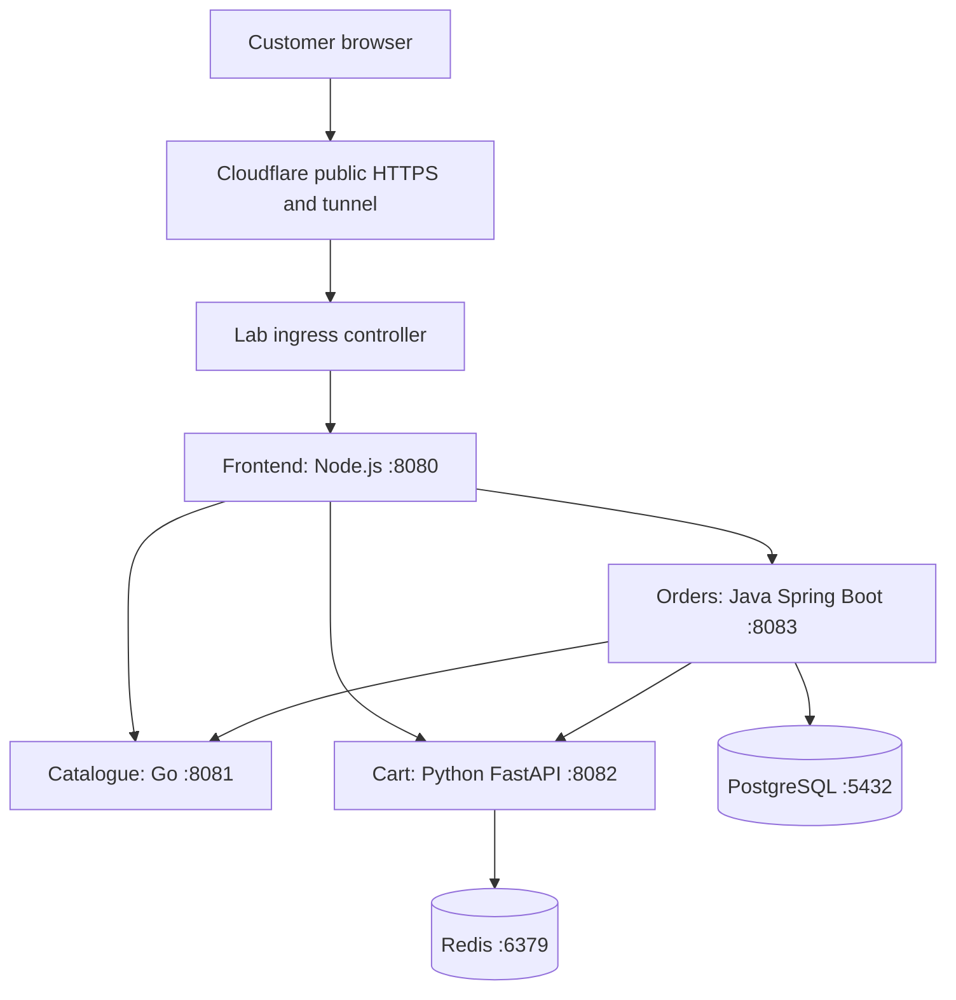
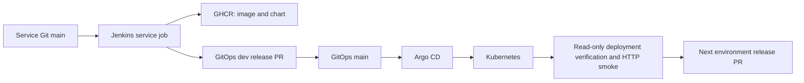
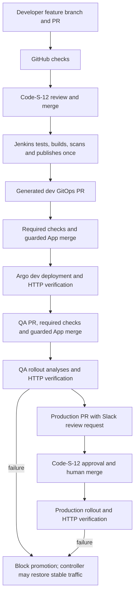

# Boutique: understand, build and operate the project

A practical DevOps learning guide. Updated against the seven organisation repositories and verified operations on **19 October 2026**.

For a first read, follow sections 1–5 for the big picture, 6–11 for delivery and operations, 12–14 for Python, and section 15 to rebuild it in stages. Sections 16 and 20 are your troubleshooting reference. Read this from top to bottom when you want the complete story. Later, use the contents as a reference. This describes the current laptop lab and its code; it does not claim that a laptop is a highly available production platform.

**Do you need Python? Yes: enough to read, troubleshoot and safely change the automation you operate.** You do not need to memorize these programs or become an application developer. Sections 12–14 explain exactly what to learn and how the scripts work.

Commands in this document are instructions for you to run deliberately. Writing this document did not run deployments, build images, merge PRs or exercise rollback. Commands marked **changes state** modify something. Examples containing `REPLACE_...` require your own values.

## Contents

1. [The project in plain English](#1-the-project-in-plain-english)
2. [Vocabulary before commands](#2-vocabulary-before-commands)
3. [Architecture and request flow](#3-architecture-and-request-flow)
4. [Repositories and ownership](#4-repositories-and-ownership)
5. [The complete release journey](#5-the-complete-release-journey)
6. [Docker: what the images contain](#6-docker-what-the-images-contain)
7. [Kubernetes: where the images run](#7-kubernetes-where-the-images-run)
8. [Helm and GitOps: how configuration becomes workloads](#8-helm-and-gitops-how-configuration-becomes-workloads)
9. [Jenkins and the shared library](#9-jenkins-and-the-shared-library)
10. [Release safety, promotion and rollback](#10-release-safety-promotion-and-rollback)
11. [Monitoring, scaling and data recovery](#11-monitoring-scaling-and-data-recovery)
12. [Python knowledge a DevOps engineer needs](#12-python-knowledge-a-devops-engineer-needs)
13. [GitOps Python explained](#13-gitops-python-explained)
14. [CI, platform and infrastructure Python explained](#14-ci-platform-and-infrastructure-python-explained)
15. [Build this from scratch in a clean order](#15-build-this-from-scratch-in-a-clean-order)
16. [Daily commands and troubleshooting](#16-daily-commands-and-troubleshooting)
17. [Learning exercises and interview explanations](#17-learning-exercises-and-interview-explanations)
18. [Current limitations and unfinished work](#18-current-limitations-and-unfinished-work)
19. [Source snapshot and further reading](#19-source-snapshot-and-further-reading)
20. [Operating runbooks](#20-operating-runbooks-detect-recover-and-verify)

## 1. The project in plain English

Boutique is a small online shop used to practice operating software. A customer browses products, adds things to a cart and places an order. Four application services cooperate to do that.

The DevOps problem is bigger than starting four processes. We need to answer:

- Which source change produced the running software?
- Did it pass tests and security checks?
- Did QA test the exact artifact that production will receive?
- Who allowed a production change?
- What happens if the new release fails?
- Can we see failures and recover data?

This project connects GitHub, Jenkins, Docker, GHCR, Helm, Argo CD, Kubernetes and monitoring to answer those questions.

Think of a release as a sealed parcel. CI builds and labels the parcel once. Dev, QA and production receive that same parcel. The environment settings can differ, but we do not rebuild the parcel between environments.

A successful image build only proves the parcel exists. A verified deployment proves that the intended parcel is running and that basic customer actions work.

## 2. Vocabulary before commands

| Term | Plain meaning | Here |
|---|---|---|
| Repository | A versioned folder of code | Eight GitHub repositories |
| Commit SHA | An identifier for an exact Git snapshot | Full source and GitOps revisions |
| Branch | A movable name pointing at commits | `main`, a feature branch, a release branch |
| Pull request, PR | A proposed change with checks and a merge decision | Source changes and GitOps releases |
| CI | Automatically check and package a change | Tests, scans, image and chart publication |
| CD | Deliver approved software into an environment | GitOps PRs, Argo reconciliation, verification |
| Artifact | A build output we can reuse | Container image, chart archive, SBOM |
| Container image | A packaged filesystem plus startup instructions | An application image in GHCR |
| Container | A running instance of an image | Inside a Kubernetes Pod |
| Tag | A readable image label | Source commit tag; labels can be moved in general |
| Digest | A content identifier | `sha256:...`, used for deployment identity |
| GHCR | GitHub Container Registry | Stores images and OCI Helm charts |
| Cluster | Kubernetes control plane and workers | The `mega-local` kind cluster |
| Node | A machine Kubernetes schedules Pods onto | A Docker container in this kind lab |
| Pod | Kubernetes' smallest scheduled unit | Usually one application container here |
| Namespace | A grouping and policy boundary | `boutique-dev`, `boutique-staging`, `boutique-production` |
| Deployment | Maintains replicas and updates ordinary Pods | Dev application workloads |
| ReplicaSet | Maintains Pods for one workload revision | Managed by Deployment or Rollout |
| StatefulSet | Workload with stable identities/storage | PostgreSQL and Redis |
| Service | Stable DNS name and routing to selected Pods | `catalogue:8081` |
| Ingress | HTTP routing from an entry point to Services | Environment hostnames |
| Helm chart | Templates plus default configuration | A reusable service deployment package |
| Helm values | Inputs to those templates | Replicas, resources, origins, image digest |
| GitOps | Keep desired deployment state in Git | Argo CD reconciles GitOps `main` |
| Reconciliation | Compare desired state with actual state and correct it | Argo sync/controller loops |
| CRD | Extends Kubernetes with a new resource type | `Rollout`, `AnalysisTemplate` |
| Rollout | Argo Rollouts' deployment controller resource | QA/prod blue-green delivery |
| RBAC | Who can do which API operations | Jenkins verifier can read, not deploy |
| HPA | Adjust replicas from measured load | QA/prod frontend CPU scaling |
| SBOM | A list of software components in an artifact | Generated with Syft |
| SLI / SLO | Measured service signal / target for it | Availability, errors, latency |
| RPO / RTO | Acceptable lost data / recovery time | Must be measured and agreed, not guessed |

Two different meanings of “stage” cause confusion: a **Jenkins stage** is one step inside a job; **staging/QA** is an environment. Our QA job targets the `boutique-staging` namespace. Environment arguments remain `dev`, `staging` and `production`; namespace names include the `boutique-` prefix.

## 3. Architecture and request flow

### 3.1 Customer traffic



Each environment has its own application resources and local data services. A cart in dev is not a production cart. The browser reaches the frontend; the frontend makes the internal service calls.

| Service | What you must know operationally | Important configuration |
|---|---|---|
| Frontend | Serves UI and acts as the browser-facing backend; port 8080 | `SESSION_SECRET`, `PUBLIC_ORIGIN`, `COOKIE_SECURE`, three upstream URLs |
| Catalogue | Product lookup; Go binary; port 8081 | Service address and probes; product data is hardcoded for the lab |
| Cart | FastAPI service; port 8082; depends on Redis | `REDIS_URL`; carts have a seven-day TTL |
| Orders | Spring Boot; port 8083; depends on PostgreSQL and other services | `DATABASE_URL`, `DATABASE_USER`, `DATABASE_PASSWORD`, upstream URLs |
| PostgreSQL | Persistent orders and schema history | Password Secret, PVC, backups, capacity |
| Redis | Cart data | Authentication, PVC, memory and persistence |

Frontend sessions use signed cookies with browser protections. The session secret must be at least 32 characters and must remain stable across frontend replicas. Changing it invalidates existing sessions.

Orders runs Flyway migrations at startup. This is why deployment rollback and database recovery are separate decisions: an old application image does not automatically undo a database migration.

You need to understand ports, dependencies, health endpoints, configuration, storage and failure behavior. You do not need to explain the internal Java classes to operate this project.

### 3.2 Delivery and control planes



Jenkins builds artifacts and proposes changes. Argo CD applies approved desired state. Kubernetes controllers keep workloads running. The verifier checks what actually happened.

### 3.3 The actual laptop

Current context: `kind-mega-local`. It has one control-plane node and two workers, all Docker containers on the same laptop. Kubernetes version is v1.34.0.

The host has roughly 4 CPUs and 8 GiB RAM. Three kind nodes do **not** turn that into 12 CPUs and 24 GiB. Every component shares the same physical resources.

Other host containers include Jenkins, the build agent and rootless BuildKit. The build agent uses a private rootless Docker daemon. Do not assume it uses the host's privileged Docker socket.

The Jenkins controller has zero executors. The trusted build agent currently has four. Multiple jobs can therefore compete with monitoring, Kubernetes and the database. `disableConcurrentBuilds()` prevents overlap within one job; it does not limit all jobs globally.

### 3.4 Addresses and TLS

| Environment | Public origin | Kubernetes namespace |
|---|---|---|
| Dev | `https://dev-boutique.narx.space` | `boutique-dev` |
| QA | `https://staging-boutique.narx.space` | `boutique-staging` |
| Production lab | `https://shop.narx.space` | `boutique-production` |
| Grafana | `https://grafana.narx.space` | Monitoring resources |

Public HTTPS terminates at Cloudflare. App ingress in the laptop profiles currently uses HTTP on the origin side; local PostgreSQL/Redis connections are also plaintext inside the cluster. Public HTTPS is not proof of end-to-end internal TLS.

The Kubernetes API endpoint currently uses a loopback address with a mapped port. Discover it from kubeconfig instead of assuming a permanent port. Public tunnel hostnames avoid depending on a changing Wi-Fi LAN address, but Docker, the tunnel, the cluster and Jenkins still need to start after a laptop reboot.

**Ingress maintenance issue:** this lab still uses community ingress-nginx, whose upstream maintenance ended in March 2026. A new long-lived setup should use a maintained controller. A migration must update ingress classes, controller-specific annotations and NetworkPolicies together. This guide does not pretend that installing a different controller alone completes that migration. [Kubernetes announcement](https://kubernetes.io/blog/2026/01/29/ingress-nginx-statement/)

## 4. Repositories and ownership

The organisation contains seven project repositories. Optional cloud infrastructure is outside this organisation and is not required for this laptop setup. Example local paths use `/root/devops-boutique`; replace that prefix with your own workspace. This document is published in `boutique-ci`.

| Repository | Owns | Start reading here |
|---|---|---|
| `boutique-frontend` | UI/browser gateway image and service chart | `Dockerfile`, `Jenkinsfile`, `helm/`, `ci/test.sh` |
| `boutique-catalogue` | Catalogue image and chart | Same operational entry points |
| `boutique-cart` | Cart image and chart | Same; `app.py` only for runtime contracts |
| `boutique-orders` | Orders image and chart | Same; `pom.xml`, `certs/`, migration implications |
| `boutique-ci` | Shared library, job definitions, release orchestration | `vars/`, `pipelines/`, `scripts/` |
| `boutique-gitops` | Desired environments and selected release artifacts | `applications/`, `environments/`, `laptop-profiles/`, `scripts/` |
| `boutique-platform` | Local platform, monitoring, rollout assets, verification, recovery | `scripts/`, `monitoring/`, `kubernetes/`, `local/` |

Why separate these? A UI change should not require rewriting Kubernetes installation code. A replica change should not require rebuilding the UI. A CI implementation change should be reviewed independently from a production release selection.

The practical boundary is:

```text
service source + Dockerfile -> image
service helm/              -> reusable chart
GitOps release selection   -> which image/chart each environment gets
platform                   -> controllers and operational tools
CI library                 -> connects those steps
infrastructure             -> optional cloud foundations
```

The active GitOps applications are `boutique-dev`, `boutique-staging`, `boutique-production`, `boutique-monitoring-homelab` and `boutique-metrics-server`. The word `homelab` in the monitoring application is an active name; it does not mean that deleted legacy application profiles are still needed.

This is the single project guide. Platform’s retired two-cluster bootstrap and duplicate docs directory have been removed. Use the staged installation below and the active operator helpers; the current environment is kind-mega-local.

## 5. The complete release journey

### 5.1 From a source change to dev

1. Create a service feature branch and change code.
2. Push it and open a PR. GitHub Actions runs checks on an ephemeral runner without publishing/deployment credentials.
3. Obtain Code-S-12 code-owner approval and merge the checked PR into protected `main`.
4. The service's Jenkins `main` job checks out that exact source revision.
5. The library decides whether this change needs a release. It always scans the source for secrets.
6. For a release: check/package Helm; run the test image and runtime build in parallel; scan the runtime image and generate its SBOM in parallel.
7. Publish the image and chart. Record source SHA, image digest and chart archive as build artifacts.
8. Queue the dev delivery job with that exact publishing build number.
9. The dev job copies that build's release artifacts and edits the GitOps release selection.
10. It creates a dev GitOps PR. Trusted validation checks it. The Jenkins App merges generated dev promotions after both required checks pass; a strict guard permits only the selected service image/chart change.
11. Argo sees the merged desired state and reconciles dev.
12. The dev job's verification action checks revision, image, chart, controller state and public functionality.

If a step fails, investigate that step. Rebuilding a successfully published image is usually not the correct way to repair a failed Argo sync.

### 5.2 Dev to QA to production

After dev verification succeeds, the QA promotion job copies the selected **image digest and exact chart package** from dev into staging. It does not rebuild the service image. The generated QA promotion PR merges automatically after validation, followed by QA deployment verification and smoke tests.

After QA verification succeeds, production promotion creates a production PR. Code-S-12 reviews the change; an authorised human **manually merges** it after checks pass. Approval authority and permission to perform the merge are separate: an allowed writer may merge an approved PR, but cannot skip its required review/checks. A watcher waits for that merge and queues production verification against the merged GitOps commit.

Human changes across all seven repositories require Code-S-12 code-owner approval, passing checks and a PR. The Jenkins App has a PR-only review exemption for guarded dev/QA promotions; it cannot bypass the separately enforced required checks. New pushes dismiss earlier approvals. An approval and a merge are different actions; the watcher resumes after merge.



Checks run before review is granted. A bot does not approve a developer's code.
The `code-reviewers` team currently contains Code-S-12; CODEOWNERS names that
account explicitly. Being an organisation owner or another team member does not
replace the configured code-owner approval. Branch rules and App permissions are
part of the delivery configuration, so check them when changing organisations.

### 5.3 Copying the image is the intended practice

Promotion copies a reference to immutable content, not source code that gets rebuilt differently.

```text
source commit A
       |
       v
image digest sha256:X + chart version 0.1.0-A
       |
       +--> dev
       +--> staging
       +--> production
```

A rebuild could use changed dependencies or toolchain inputs and produce digest Y. QA's evidence for X would then not prove that Y was tested. Build once; promote the tested artifact. Environment settings remain environment-specific.

### 5.4 Three identities to keep straight

| Identifier | Means | Example use |
|---|---|---|
| Service source SHA | Code used to build one service | Chart version and release provenance |
| Image digest | Exact container content | Workload image selection |
| GitOps commit SHA | Entire desired environment state at a point in time | Deployment verification and rollback selection |

A rollback command asking for a GitOps commit does not accept an arbitrary frontend source SHA as a substitute.

### 5.5 When a run intentionally does nothing

A docs-only service change can finish without publishing an image or creating a release PR. Promotion also becomes a no-op when the target already selects exactly the same release. No PR in either case can be correct behavior.

The latest service rebuild filter is active in the pinned library, but its fresh manual Jenkins end-to-end exercise was explicitly deferred. Its regression checks passed in GitHub; do not describe the manual rollout exercise as completed.

## 6. Docker: what the images contain

### 6.1 Read a Dockerfile as a recipe

```dockerfile
FROM some-approved-base@sha256:... AS test
WORKDIR /app
COPY dependency-files ./
RUN install-dependencies
COPY source ./
CMD ["run-tests"]
```

This is an illustration, not a buildable replacement for a real Dockerfile.

- `FROM` chooses a starting filesystem. The digest pins its exact content.
- `WORKDIR` chooses the working directory for later instructions.
- `COPY` brings selected build-context files into the image.
- `RUN` executes while building an image layer.
- `USER` selects the runtime user.
- `EXPOSE` documents a container port; it does not publish a host port.
- `CMD` supplies the default runtime command. An `ENTRYPOINT` fixes the executable and accepts additional arguments.
- `AS test` names a stage. `--target test` builds that stage rather than the final runtime stage.

`CMD` does not run during `docker build`. Building the test stage is preparation; running the resulting test image actually runs tests.

### 6.2 The four real Dockerfiles

| Service | Test/build stages | Final runtime |
|---|---|---|
| Frontend | Node 22 Alpine; `npm ci --ignore-scripts`; tests and `ci/` copied into test stage | Node with only required runtime files; npm/corepack removed; `USER node`; port 8080 |
| Catalogue | Go 1.26.9; tests separate from compilation; `CGO_ENABLED=0`, trimmed binary | Alpine, compiled binary, UID/GID 10001; port 8081 |
| Cart | Python 3.12; hashed requirements; wheel build and separate test dependencies | Installs approved wheels offline; no test toolchain; UID/GID 10001; Uvicorn on 8082 |
| Orders | Maven 3.9.9/JDK 21; dependency cache; test stage, then packaging with `-DskipTests` | Java 21 JRE, application JAR and CA files; UID/GID 10001; port 8083 |

Orders' packaging skips another test pass because the pipeline already runs the test stage. This saves duplicated work; it does not mean the whole release skips tests.

Java `MaxRAMPercentage=70` leaves room for non-heap memory. It does not guarantee that a poorly sized Pod can never be OOM-killed.

### 6.3 Why build contexts and caches matter

Docker sends a build context to the builder. `.dockerignore` controls what is excluded. Copying dependency manifests before frequently changing source lets dependency layers be reused.

There are several independent caches:

| Cache | Helps | Does not prove |
|---|---|---|
| Docker/build cache | Reuses build layers | Running cluster selected the new image |
| Maven/npm/pip caches | Avoids downloads | New source was tested |
| Scanner DB/schema cache | Avoids repeated metadata downloads | Findings can be ignored |
| Browser/CDN cache | Reuses web assets | Deployment identity is correct |

Do not put passwords, kubeconfigs or `.env` files into the context. Deleting a secret in a later layer does not remove it from earlier layers.

### 6.4 Local image commands

**Changes state locally:** these create images and containers; they do not publish or deploy. Run from a service repository.

```bash
cd /root/devops-boutique/boutique-frontend
docker build --target test -t boutique-frontend:test .
docker run --rm boutique-frontend:test
docker build -t boutique-frontend:local .
docker image inspect boutique-frontend:local --format '{{.Id}}'
```

Use the corresponding service directory/name for catalogue, cart or orders. Their test scripts may start fixtures or need the environment documented in that repository; Jenkins is the reference implementation for those details. Do not mount a privileged Docker socket merely to make a test work.

For isolated learning, first use a local tag. Publishing commit-tagged images for a commit Jenkins already published can be refused by the overwrite guard.

## 7. Kubernetes: where the images run

### 7.1 A minimal workload mental model

A workload template says: use this image, start this command, give it these resources, supply this configuration, check these endpoints and maintain this many replicas.

A Service selects matching Pods and gives them stable DNS. Pod IPs can change; other services should use Service DNS names rather than hardcoded Pod IPs.

A ConfigMap holds non-secret settings. A Secret holds sensitive values. Kubernetes Secret data being base64 encoded is not encryption; control API access and storage protection.

### 7.2 Health checks

- **Liveness:** is this process stuck such that restarting may help?
- **Readiness:** can this Pod currently serve traffic?
- **Startup:** should Kubernetes allow a slow startup before normal checks begin?

Application health endpoints include `/health/live` and `/health/ready`. Frontend readiness also checks its dependencies. Orders' metrics endpoint is `/actuator/prometheus`; the other service metrics use `/metrics`.

Making liveness depend on every remote dependency can produce restart storms. A database outage should normally remove traffic from unready Pods while preserving useful process diagnostics.

### 7.3 Resource requests, limits and restarts

Requests influence placement and CPU allocation. Limits bound consumption. A memory-limit breach can cause `OOMKilled`. A CPU limit usually causes throttling, not an OOM kill.

`CrashLoopBackOff` is a repeated-start-failure symptom. Find the reason in events, previous container logs, probes, configuration and resource status. Raising restart counts is not a diagnosis.

### 7.4 Current environment differences

| Property | Dev | QA / staging | Production lab |
|---|---|---|---|
| App controller | Deployment | Blue-green Rollout | Blue-green Rollout |
| Normal frontend replicas | 1 | HPA: 2–3 | HPA: 2–3 |
| Normal backend replicas | 1 each | 1 each | 2 each |
| Automatic rollout recovery | No | Yes, analysis window | Yes, analysis window |
| PDB | Disabled | Disabled | `minAvailable: 1` per service |
| Database topology | Local single instance | Local single instance | Local single instance |

Dev Deployment updates use `maxSurge: 1`, `maxUnavailable: 0`: create one extra Pod and avoid deliberately taking an available replica down first. Scheduling capacity and readiness still matter.

QA/prod keep reference Deployments at zero replicas after handing control to the Rollout. A zero-replica reference Deployment there is expected. Look at Rollouts and their ReplicaSets to find the serving Pods.

A PodDisruptionBudget limits voluntary evictions. It does not prevent laptop failure, kernel crashes or every kind of application outage.

### 7.5 Network and identity

Each service uses a Kubernetes ServiceAccount. NetworkPolicies describe allowed traffic, including app dependencies and rollout analysis access. A policy only enforces traffic if the cluster's network implementation supports enforcement; verify it when building a new cluster.

Jenkins deployment-verification identities are read-only and scoped. Jenkins should not need an administrator kubeconfig to publish an image or open a release PR. Installing CRDs, RBAC and controllers is a separate administrator activity.

## 8. Helm and GitOps: how configuration becomes workloads

### 8.1 Service charts

Each service repository has a `helm/` chart. Inspect its `Chart.yaml`, `values.yaml`, `values.schema.json` and templates.

The reusable chart creates the service workload, Service, ServiceAccount and optional PDB. Templates are configuration-generating code: changes can affect every environment that selects the resulting chart package.

Illustrative template:

```yaml
image: "{{ .Values.image.repository }}@{{ .Values.image.digest }}"
```

The actual chart also contains validation/defaulting logic. Render it to see the real Kubernetes YAML instead of mentally substituting dozens of values.

### 8.2 Environment wrapper charts

In `boutique-gitops`:

```text
environments/
  dev/
  staging/
  production/
    Chart.yaml        # dependencies and exact chart versions
    values.yaml       # environment configuration
    releases.yaml     # selected immutable service images
    charts/*.tgz      # exact selected service chart packages
    templates/        # namespace/platform and progressive resources
laptop-profiles/
  dev/values.yaml
  staging/values.yaml
  production/values.yaml
applications/
  laptop-projects.yaml
  laptop-appset.yaml
  monitoring-homelab.yaml
  metrics-server.yaml
```

The tree shows the same kinds of files inside each environment; `production/` is expanded for readability.

Rendering precedence, from lower to higher priority:

```text
service chart defaults
  -> environments/ENV/values.yaml
  -> environments/ENV/releases.yaml
  -> laptop-profiles/ENV/values.yaml
```

The cloud profile omits the laptop override. A cloud render is a validation target, not evidence that AWS infrastructure is running.

`releases.yaml` selects image repository plus digest, with an empty tag. Chart dependencies use versions such as `0.1.0-<full-source-SHA>`. The matching `.tgz` packages are committed, so Argo renders the reviewed chart bytes rather than fetching a newly changed dependency.

Do not casually run `helm dependency update`: replacing selected packages changes release inputs. Promotion scripts manage those inputs together.

### 8.3 Rendering is not deployment

**Read-only; requires Helm/Python dependencies:**

```bash
cd /root/devops-boutique/boutique-gitops
python3 scripts/render.py dev --profile laptop > /tmp/boutique-dev.yaml
python3 scripts/render.py staging --profile laptop --lint > /tmp/boutique-staging.yaml
python3 scripts/check_rendered_images.py --environment staging --profile laptop \
  --rendered-file /tmp/boutique-staging.yaml
```

Rendering produces YAML. The image policy checker verifies that the rendered workloads still match the authorized release and progressive-delivery policy. Neither command applies that YAML.

The complete validation entry point is:

```bash
bash scripts/validate.sh
```

It needs the repository's toolchain, including Helm, kubeconform, Python dependencies and access to the expected schema assets. Run it in the approved CI agent/tool environment or provision those tools first. It does more than `helm lint`.

### 8.4 Validation without wasting work

Validation checks Helm syntax/rendering, Kubernetes schemas, authorized images, Argo source boundaries, rollout resources and HPA policy. Full validation covers app profiles plus monitoring and metrics-server profiles.

A narrowly scoped release-only change can validate affected environments. Unknown or broad changes fall back to wider validation. Already-rendered manifests can be passed to image validation instead of rendering a second time. Shared templates, policies and schemas still need broad checks because one edit can affect several environments.

A fast check that misses a changed environment is not a useful optimization.

### 8.5 Argo CD ownership

The ApplicationSet creates the three application Applications. AppProjects constrain allowed sources and destinations. Application sources point to GitOps configuration and the chosen profile.

Argo CD uses Helm to **render** resources. It does not necessarily create a Helm release record. Therefore `helm list` can show no boutique releases while Argo-managed boutique resources are healthy.

Git owns image selections and workload templates. Some runtime fields belong to controllers:

- HPA owns frontend Rollout replica count.
- Rollouts manages reference Deployment scale and Service revision selectors.

Narrow Argo ignore rules, together with `RespectIgnoreDifferences`, allow that cooperation. Ignoring every difference would hide configuration drift and defeat GitOps.

## 9. Jenkins and the shared library

### 9.1 Jobs you should recognize

| Job or entry point | Responsibility |
|---|---|
| `Services/boutique-frontend/main` and other three service jobs | Test, scan, publish, request dev delivery |
| `Deployments/boutique-deploy-dev` | Promote to dev or verify dev |
| `Deployments/boutique-deploy-qa` | Promote to staging or verify staging |
| `Deployments/boutique-deploy-prod` | Propose production promotion or verify production |
| `Release Operations/boutique-gitops-validate` | Wait for required GitHub PR checks, then handle eligible release PRs |
| `Release Operations/boutique-release-verify` | Watch a promotion PR in any environment for merge, then queue verification |
| `Release Operations/boutique-rollback` | Propose a known-good release through a GitOps PR |
| `Administration/boutique-seed-release-pipeline` | Create/update job definitions from reviewed CI code |

The old combined promotion/verification jobs were retired. Separate environment job names make ownership and history easier to follow; shared code prevents three copies of the implementation.

### 9.2 Why the service Jenkinsfile is small

A service Jenkinsfile delegates to a shared function, conceptually:

```groovy
@Library('boutique-ci') _
servicePipeline(service: 'frontend')
```

The shared library centralizes release behavior. Four services should not carry slightly different copies of registry credentials, scans, PR logic and verification rules.

The real release behavior is in `boutique-ci/vars/`, not just the tiny service Jenkinsfile.

### 9.3 Read the shared library in this order

**`servicePipeline.groovy`**

It allows the four application service names, verifies release-controller/main-branch conditions, checks out source, establishes isolated tool/cache/Docker state, decides whether to release, verifies protected-main ancestry and runs source secret scanning. For a real release it validates/packages the chart, executes tests/build in parallel, scans/generates SBOM in parallel, then publishes and archives provenance. Only a published release queues dev delivery.

**`releaseChanges.groovy`**

It finds the last successful build containing valid source and release-image metadata for the same service. It compares that source to the current source. Known documentation-only paths can skip expensive release work. Missing history, an invalid baseline, divergent history or an unknown path causes a full release.

Examples that can be skipped: `docs/`, `.github/`, `README.md`, `Jenkinsfile`, license/contribution text and selected editor metadata. This is the current deliberate allowlist. A future change in what the Jenkinsfile itself controls should prompt review of this policy.

Examples that need a release: Dockerfile, `.dockerignore`, dependencies, service source, Helm, `ci/test.sh` or unknown files. Renames are compared without rename collapsing, so moving runtime source into docs still exposes the source deletion. A failed app build followed by a docs change cannot use that failed build as a successful baseline.

This optimization avoids unnecessary publication. It is separate from Docker layer caching, and source secret scanning remains active.

**`releaseArtifact.groovy`**

It accepts a numeric publishing build, copies that build's exact `image-digest.txt`, `source-commit.txt` and chart archive, checks their identity, then passes them into dev release selection. It prevents accidentally taking whatever an unrelated “latest successful” build happens to contain.

**`environmentPipeline.groovy`**

It implements `promote` and `verify` for a fixed environment. Promotion edits release selections and opens a PR if there is a diff. Verification checks approved history, Argo state, workload ownership and real functionality, then queues the next environment when appropriate.

**`gitopsPullRequest.groovy`**

It creates a release branch, commits allowed GitOps changes, opens a PR, queues validation and archives review information. Typical branch shape is `jenkins/promote/staging/frontend/BUILD_NUMBER`. It does not deploy with `kubectl apply`.

### 9.4 Pipeline files

| File under `boutique-ci/pipelines/` | Important behavior |
|---|---|
| `deploy-dev.Jenkinsfile` | Small wrapper fixing target to dev |
| `deploy-qa.Jenkinsfile` | Small wrapper fixing target to staging |
| `deploy-prod.Jenkinsfile` | Small wrapper fixing target to production |
| `gitops-validate.Jenkinsfile` | Waits for required GitHub checks on the exact PR head, then merges eligible dev/QA releases and queues the merge watcher |
| `release-verify.Jenkinsfile` | Waits for reviewed dev/QA/production merges without holding an executor throughout polling |
| `rollback.Jenkinsfile` | Requires a known-good full GitOps revision and creates a rollback PR |
| `seed-release.Jenkinsfile` | Loads Job DSL definitions with controlled bootstrap behavior |

The GitOps pull request workflow runs fast policy tests and full Helm/schema/image validation for every PR. Its validator uses scripts from the protected base revision and treats PR content as configuration data. Jenkins waits for the required GitHub checks before any release-verification handoff; it does not duplicate manifest validation. The PR head is checked again so results for commit A cannot silently authorize a later commit B.

Generated dev/QA promotions are merged by the protected validator after strict App/head/path/semantic authorization and successful checks. Production and configuration changes require code-owner review. The release watcher observes merges; it does not approve PRs. Rollback PRs still require explicit post-merge verification.

### 9.5 Shared-library pinning

The global untrusted library is named `boutique-ci`. Its current default is pinned to:

```text
REVIEWED_CI_COMMIT_SHA
```

The seed SCM revision is pinned as well. These are deliberate immutable references. Merging a CI PR does not automatically advance either explicit pin.

For a library update:

1. Create a CI PR and let required checks pass.
2. Review and merge it.
3. Record the full merged SHA.
4. Update the Jenkins global library default and seed SCM pin to the reviewed SHA.
5. Review the seed configuration and run the seed when changing generated jobs.
6. Exercise the changed behavior when testing is authorized.

Do not fix a sandbox rejection by granting unrestricted script execution or approving everything. Preserve the library's intended trust boundary.

### 9.6 Credentials and configuration

| Jenkins credential | Purpose | Never use it for |
|---|---|---|
| `github-read` | Read source | Publishing or administrator operations |
| `github-service-ci` | Scoped GitHub App access/status reporting for the four service repos | Unrelated repos or organisation administration |
| `ghcr-publish` | Publish approved artifacts | Untrusted PR code |
| `gitops-release-app` | GitHub App authentication for release PRs | Broad personal-account administration |
| `slack-delivery-webhook` | Channel-specific delivery notifications | PR runners, application containers or log output |
| `gitops-checks` | Read GitOps PR/check metadata for release orchestration | Writing commit statuses or runtime Kubernetes administration |
| `kubeconfig-dev` / `kubeconfig-staging` / `kubeconfig-production` | Read-only verification | Applying workloads or reading every Secret |

Older instructions may name a PAT fallback `gitops-pr`; the active setup uses `gitops-release-app`. The organisation App needs Commit statuses read/write and installation access to the intended repos. The Jenkins service credential is scoped to the four services, while the release credential is scoped to GitOps. The App has no repository Administration permission. GitOps required checks have no App bypass; the separate PR-review exemption is used only by protected dev/QA authorization logic. Private CA credentials are only used when private-CA mode is enabled; public Cloudflare origins use normal public trust.

Important global configuration includes `BOUTIQUE_CONTROLLER_ROLE=release`, `BOUTIQUE_RELEASE_AUTOMATION=true`, the three `BOUTIQUE_*_ORIGIN` values, `BOUTIQUE_SLACK_ENABLED=true`, and the expected release-bot credential/login/numeric IDs. Match these to the library before enabling automation in a fresh installation.

Never commit credential values into a Jenkinsfile, put them into Docker build arguments or paste them into a troubleshooting screenshot. A credential ID is a reference; it is not the credential itself.

### 9.7 Why a pipeline can still take time

Real release work includes dependency access, four different language toolchains, Docker builds, tests, vulnerability databases, image uploads and deployment analysis. A cold laptop run differs from a cached run.

Current useful optimizations include parallel tests/runtime builds, parallel image scanning/SBOM generation, avoiding duplicate packaging tests, reusing rendered manifests, validation scoping and skipping documentation-only releases.

Next optimize from measured stage durations. More executors are not automatically faster on a four-CPU laptop. Limit cross-job concurrency before increasing parallelism further. Do not remove required release verification just to make a green timer shorter.

## 10. Release safety, promotion and rollback

### 10.1 Blue-green explained

Imagine two shop counters. Customers use the active counter. We prepare a new counter privately, inspect it, switch traffic and inspect again. If the new counter fails the post-switch check, traffic can return to the previous healthy counter while it is still retained.

QA/prod use active and preview Services plus pre- and post-promotion analyses. Backend and checkout probes test more than a Pod's process being alive.

The current configuration includes a 300-second progress deadline, a 600-second old-ReplicaSet retention delay and a 30-second aborted-preview scale-down delay. Read the selected configuration before assuming these values are permanent guarantees.

`maxSurge` in a native Deployment and blue-green capacity are different models. Blue-green may temporarily keep active, preview and old replicas; reserve enough memory for that overlap.

### 10.2 What automatic rollback does

During the configured rollout observation period, failed analysis can abort promotion or restore traffic. The verifier still reports the attempted release as failed. “Customers recovered” must not be translated into “promote the failed release to production.”

It does **not** continuously watch every future failure and revert Git. It does not reverse Flyway migrations, restore PostgreSQL or fix corrupted Redis data. A controller can protect traffic during delivery while Git still needs a corrective release decision.

### 10.3 Manual rollback through Git

Pick a known-good **GitOps** commit that selected a healthy release of the affected service. Use the rollback pipeline to create a PR. Review the image and chart diff, pass checks and merge it.

For understanding, the underlying file-changing command is:

```bash
# Changes the GitOps working tree; does not push, merge or deploy.
cd /root/devops-boutique/boutique-gitops
python3 scripts/rollback.py frontend production REPLACE_FULL_KNOWN_GOOD_GITOPS_SHA

git diff -- environments/production
```

Use a clean branch and full trusted history; the script checks approved `origin/main` ancestry. Do not execute this on a dirty checkout or substitute a service source SHA.

Rollback PRs need manual merging. The ordinary release-promotion watcher recognizes promotion branches, so do not assume a manual rollback PR automatically receives the same verification handoff. After merging, explicitly run the fixed environment job's verification action with the merged revision and selected image, or run the local verifier and smoke test deliberately.

Avoid `kubectl set image` as the normal rollback method: Argo can restore the Git-selected image. Emergency live intervention must be followed by a reconciled Git change and verified recovery.

### 10.4 Why production PRs sometimes appear missing

Check the chain in order:

1. Did the source build publish a release, or was it an intentional docs-only skip?
2. Did dev promotion actually change a selected release?
3. Did dev verification succeed and queue QA promotion?
4. Did QA PR checks pass and merge?
5. Did QA verification succeed and queue production promotion?
6. Does production already select that exact image/chart?
7. Did bot credentials, branch policy or PR creation fail?

A successful source build is not evidence that every downstream step completed. Start with the job that should hand off to the missing step.

### 10.5 Why UI changes can appear stale

First identify the selected release. Compare source SHA, image digest, GitOps selection, Argo revision and live frontend image. Only after those agree should you investigate browser or CDN behavior.

Frontend HTML uses `no-store`; JS/CSS use content-hashed filenames with immutable caching. A changed asset receives a new URL. That protects fresh HTML from referring to an old asset name indefinitely.

Hard-refreshing cannot fix production still selecting yesterday's image. Rebuilding cannot fix opening the QA URL while expecting dev. A Cloudflare cache rule that overrides intended HTML headers can still need investigation.

## 11. Monitoring, scaling and data recovery

### 11.1 Know which component does what

| Component | Job |
|---|---|
| Prometheus | Collect and query numeric metrics; evaluate alert rules |
| Alertmanager | Group, route and silence alerts; deliver notifications |
| Grafana | Explore metrics/logs and display dashboards |
| Loki | Store/query logs |
| Alloy | Collect and ship logs from the runtime |
| Metrics Server | Supply recent resource metrics to Kubernetes HPA/`kubectl top` |

Prometheus and Metrics Server are different systems. Installing Prometheus does not automatically make HPA CPU metrics available.

The GitOps monitoring chart is in `boutique-gitops/monitoring/`. The platform repository contains rules, tests and operational monitoring assets. Rollouts and Metrics Server installation assets live under `boutique-gitops/platform/`. There is also an alternate Compose monitoring setup for local exercises; do not confuse it with the cluster deployment.

A useful operating loop is: alert → confirm impact → inspect metrics/logs/events → identify cause → recover → verify → record prevention. A dashboard alone is not incident response.

### 11.2 What to look at

For HTTP services, start with request rate, error rate and latency. Add Pod restarts/readiness, CPU, memory, PVC capacity, controller health and delivery failures. Alert rules should have actionable thresholds, reasonable durations and a clear receiver.

The repository includes rules and routing/delivery tests. A synthetic mock receiver proves formatting/routing behavior; it does not prove that a real person receives and responds to every alert.

For a learning lab, notifications, an explanation of the action and a recovery exercise matter more than adding dozens of dashboards. Database-specific operational signals and backup-failure notification remain useful improvements; do not claim they are complete merely because general monitoring is installed.

The ServiceNow incident bridge is optional and not part of the active four-service release path.

### 11.3 HPA in this project

QA and production frontend HPA settings:

```text
scale target: Rollout/frontend
minimum: 2 replicas
maximum: 3 replicas
CPU target: 60% of requested CPU
scale-up stabilization: 30 seconds
scale-down stabilization: 300 seconds
rate limit: one Pod per 60 seconds
```

With a frontend CPU request of 100 millicores, 60% corresponds to roughly 60 millicores per Pod. It is not 60% of the whole laptop.

Simplified calculation:

```text
desired replicas = ceil(current replicas × current utilization / target utilization)
```

Kubernetes also applies readiness handling, tolerance, missing-metric rules and configured scaling behavior. The configured maximum applies to desired frontend replicas; blue-green overlap can temporarily retain additional Pods.

The Metrics Server chart is pinned and Git-managed. Kubelet TLS verification is enabled by default; the kind laptop override allows its self-signed kubelet certificates. Carrying that exception into a real production cluster would require a separate decision.

Direct HPA exercises already observed 2 → 3 → 2 in QA and production, with Argo reconciliation and functional verification. They were run directly, without Jenkins as requested.

### 11.4 Backups and restore drills

PostgreSQL is the important durable order store. Replicas and container restarts are not backups. A PVC is not a backup either: deleting or losing the underlying disk can still lose it.

`backup-k8s.py` creates custom-format PostgreSQL dumps, checksums and identity metadata. A restore drill creates a randomly named temporary database, restores there, compares relevant data where possible and removes only that temporary database. It does not overwrite the live orders database.

**Changes state:** backup creates private files and reads the database. Restore drill creates/deletes a temporary database. Run with the intended administrator context and protect the backup directory.

```bash
cd /root/devops-boutique/boutique-platform
python3 scripts/backup-k8s.py backup \
  --context kind-mega-local --environment dev \
  --destination /var/backups/boutique

# Replace with an actual dump path produced by the backup.
python3 scripts/backup-k8s.py restore-drill \
  --context kind-mega-local --environment dev \
  --destination /var/backups/boutique \
  --file REPLACE_ACTUAL_BACKUP_FILE
```

Use `--environment all` for backups of all three environments. The installed daily cron is scheduled at 02:30 with `flock` to prevent overlapping backup runs. A laptop that is off at that time misses the cron run. Verify timestamps and logs rather than assuming daily means successful daily.

Backups are private local files, not CI artifacts. Local restore practice is the agreed scope. There is no off-laptop disaster-recovery guarantee, automatic point-in-time recovery or proven uptime SLA. A real production design needs an independently protected destination, retention, failure notification and measured restore objectives.

### 11.5 What has actually been verified

These are observed results from 19 October 2026, not permanent guarantees:

| Boundary | Evidence and limit |
|---|---|
| Dev → QA → production | Frontend, catalogue and orders used the same published immutable images/charts; all three production verification jobs passed all 12 HTTP smoke checks each |
| Review policy | Human changes require Code-S-12 review; generated guarded dev/QA PRs merged through the organisation App; production PRs waited for human review/merge |
| Post-cutover recovery | A controlled QA frontend candidate received traffic, then an injected analysis failure caused automatic return to the original stable selector in about 14 seconds; this is an observation, not a recovery SLA |
| Failed release gate | Jenkins QA verification #46 failed intentionally with an aborted-release message; it did not promote the failed attempt |
| Recovery cleanup | Original QA specs/auto-sync restored and all 12 HTTP smoke checks passed; production was unchanged during the drill |
| Merge retry logic | Deterministic tests cover transient recovery, bounded exhaustion, changed heads, conflicts, policy/permission rejection and concurrent completion; the original live GitHub race was not deliberately recreated after activation |
| Slack | The actual reviewed shared-library helper delivered a connection-test message; not every real event type has been triggered end to end |
| Monitoring restart fix | Permanent policies applied, temporary policies removed, fresh kube-state-metrics API access and populated Prometheus metrics verified; Grafana health returned HTTP 200 |

Expected red drill builds are not unresolved application outages. Read the build
reason before rerunning anything. A successful frontend recovery drill does not
prove every backend failure, database restore, host disaster or external paging
path. Repeat focused recovery exercises after material delivery changes.

## 12. Python knowledge a DevOps engineer needs

### 12.1 The expected level

You should be able to:

- Explain a script's inputs, output, side effects and failure exit code.
- Follow functions, imports, loops, conditions, lists and dictionaries.
- Read JSON/YAML, handle paths and invoke tools safely.
- Recognize secrets and prevent them appearing in logs.
- Read a traceback, reproduce a failure safely and add a focused regression check.
- Understand why validation rejects a change before weakening it.

You do not need to memorize every function or rewrite the incident bridge from memory. You do need to understand the critical deployment and recovery automation you present as your own work.

### 12.2 A tiny automation example

```python
from pathlib import Path
import json
import subprocess

result = subprocess.run(
    ["kubectl", "get", "pods", "-n", "boutique-dev", "-o", "json"],
    check=True,
    capture_output=True,
    text=True,
)
pods = json.loads(result.stdout)
summary = {"pod_count": len(pods["items"])}
Path("pod-summary.json").write_text(json.dumps(summary, indent=2) + "\n")
```

Read it as: ask Kubernetes for JSON, stop if the command fails, parse the response, count Pods and write a small report. It reads cluster state and writes one local file.

`check=True` prevents silently treating a failed command as success. A list of arguments avoids shell interpolation. `capture_output=True` is useful, but logging captured output indiscriminately can still expose secrets.

### 12.3 Patterns you will see in this project

| Pattern | Why it exists |
|---|---|
| `argparse` | Defines required command-line inputs and helpful usage |
| `Path` | Handles files/directories explicitly |
| `json.loads` / YAML parsing | Converts configuration into structured data |
| `subprocess` | Invokes Git, Helm, kubectl, pg_dump or other tools |
| Validation functions | Reject malformed or unauthorized input early |
| Exceptions and nonzero exits | Stop a pipeline when a requirement fails |
| `try/finally` | Clean temporary resources even after errors |
| SHA-256 checks | Detect changed artifact bytes |
| HTTP clients | Poll APIs or exercise the app |
| `unittest` | Check policy and regressions with controlled fixtures |

YAML should be parsed as data, not executed as code. Git commands must use an explicit repository and trusted revision. A variable named `image` is not automatically safe: validate registry, digest format and expected service.

### 12.4 A practical reading method

For any script, answer these six questions before reading every line:

1. Where is it called: Jenkins, validation, cron or a person?
2. What inputs does its CLI/environment accept?
3. Does it only read, edit files, call an API or change live resources?
4. What must be true before it proceeds?
5. What causes failure, and what happens to the pipeline then?
6. How are temporary files, credentials and partial operations handled?

Start at `main()` or the CLI parser, follow one normal execution path, then follow one failure. This is much more useful than reading imports alphabetically and trying to memorize them.

## 13. GitOps Python explained

All files in this section are under `boutique-gitops/scripts/`. Together they enforce one rule: **the selected image, chart, configuration and running workload must agree.** Several small files avoid copying the same policy into promotion, rollback and validation.

### 13.1 `render.py`

**Input:** environment and profile. **Output:** rendered Kubernetes YAML. **Side effect:** invokes Helm; does not apply resources.

It chooses the approved environment directory and values-file order, optionally lints and invokes Helm. Centralizing value selection prevents local validation and CI from accidentally rendering different profiles.

Study argument parsing, construction of a subprocess argument list and explicit file paths.

```bash
python3 scripts/render.py production --profile laptop --lint > /tmp/boutique-production.yaml
```

### 13.2 `render-monitoring.py`

It renders the monitoring chart for `homelab`, `nonprod` or `production`, with the right configuration files. It is a rendering tool, not an installer.

```bash
python3 scripts/render-monitoring.py homelab --lint > /tmp/boutique-monitoring.yaml
```

There is no current `--lab` option. Old instructions using it belong to an earlier layout.

### 13.3 `release_config.py`

This is a shared Python library, not a deployment command. It provides release identities, environment/path helpers, Git operations, selected-image lookup and validation-scope decisions.

A shared `ReleaseError` gives callers a consistent failure type. Historical lookups allow rollback to inspect a trusted old selection. Scope calculations choose narrower checks only when the changed paths are understood; otherwise they choose broader checks.

Learn how small reusable functions prevent three different implementations of “what counts as a valid release.”

### 13.4 `helm_release.py`

This is the chart-artifact safety layer. It loads chart metadata and dependencies, locates packages, validates archives, finds selected releases and writes a new release selection.

Important safeguards include:

- Exactly the expected four service dependencies and authorized registry/version identities.
- Source-SHA-based chart versions and matching chart metadata.
- Archive limits: 2 MiB compressed package, 256 members and 8 MiB expanded content.
- No absolute/traversal paths, symlinks, duplicate members or unexpected nested dependencies.
- A chart content SHA for verification.

When selecting a release, it updates the dependency and image selection, copies the approved package and removes the previously selected package from the working tree. Git history still retains historical packages for rollback.

Why inspect a tar archive? A package is input supplied to trusted tooling. `../../something` inside an archive must not escape its intended directory. This is ordinary input validation with meaningful deployment consequences.

### 13.5 `promote.py`

**Input:** service, target environment and, for dev, the published image/chart/source identity. **Output:** changed GitOps files. **It does not push or merge.**

Dev receives an explicitly identified publishing artifact. Staging reads the currently selected dev release. Production reads staging. Promotion copies the same digest and chart bytes forward.

Illustrative use on a clean release branch:

```bash
# Changes working-tree release selections.
python3 scripts/promote.py frontend staging
git diff -- environments/staging
```

Dev's shape is:

```bash
python3 scripts/promote.py frontend dev \
  ghcr.io/subhankar12-spec/boutique-frontend@sha256:REPLACE_DIGEST \
  --chart-package REPLACE_PUBLISHED_CHART_TGZ \
  --source-commit REPLACE_FULL_SOURCE_SHA
```

Use actual artifact metadata and the exact repository identity published by CI; do not invent a digest from a tag or copy these placeholders literally. Normal delivery uses Jenkins so artifact identity and PR creation remain connected.

### 13.6 `rollback.py`

**Input:** service, environment, known-good full GitOps commit. **Output:** restored selection in the working tree. It checks the commit belongs to approved main history, retrieves historical image/chart data and selects those artifacts together.

It does not reset the entire repository, revert every service or restore the database. If only frontend needs recovery, unrelated healthy service releases should remain selected.

### 13.7 `check_rendered_images.py`

It checks what Helm actually produced rather than trusting values alone. It verifies the authorized service images, namespaces and workload/resource boundaries, including progressive-delivery extras and frontend HPA policy.

Why not just search YAML for `image:`? That misses unauthorized extra containers/resources, a wrong namespace or a rollout with weakened checks. Structured validation can inspect identity and policy together.

`--rendered-file` reuses a prior render. That removes duplicate Helm work without removing validation.

### 13.8 `progressive_policy.py`

A shared library for validating controller/analysis/rollout resources. It reconstructs expected protected resources from trusted templates and compares candidate configuration against that expectation.

The policy includes HPA target/range/behavior, rollout checks and network boundaries. Laptop API egress allowances differ from the narrow cloud API policy; a laptop networking exception must not silently become a cloud-wide exception.

This file is advanced. Understand what it protects before attempting to simplify it. Removing a comparison because a PR fails can remove the protection the comparison provides.

### 13.9 Tests and the shell entry point

`validate.sh` coordinates rendering, schema checks and policy checks; it is shell because it mostly orchestrates tools. Python handles structured policy and artifact logic.

`tests/test_argo_sources.py`, `test_frontend_autoscaling.py`, `test_progressive_manifests.py`, `test_rendered_validation.py` and `test_validation_scope.py` cover different boundaries. They are development checks, not scripts that run continuously in Kubernetes.

`tests/progressive_delivery_live.py` is a failure-injection exercise for an isolated fixture. Do not point it at customer-serving namespaces as a casual smoke test.

## 14. CI, platform and infrastructure Python explained

### 14.1 CI: `scripts/wait-for-pr-checks.py`

It waits for both required GitOps checks on the exact PR head, including the short gap before GitHub Actions registers its runs. Only checks from the GitHub Actions integration count. Failed/cancelled checks, a changed head, API failure or timeout stop the pipeline. The helper reads status; it never approves or merges a PR.

### 14.2 CI: `scripts/release-merge.py`

Concurrent eligible merges can receive HTTP405 while GitHub recomputes mergeability. The helper makes at most five SHA-bound merge attempts, waiting 5/10/20/40 seconds between attempts. Before a retry it re-reads PR identity/head and accepts only clean/unknown mergeability; changed heads, conflicts and policy/permission blocks stop it. This never bypasses required checks or human production review.

It parses PR metadata and expected head identity to determine whether the exact promotion PR merged, closed without merge or still needs waiting. It validates the environment, service, promotion branch, repository and base constraints.

The Jenkins watcher handles waiting; this Python code handles the structured decision. It avoids accepting an unrelated merge as permission to verify/deploy the requested release.

### 14.3 Platform: `scripts/wait-for-deployment.py`

This is the most important Python program to understand after basic promotion.

**Inputs:** environment, full GitOps commit, service, image and GitOps repository path. **Output:** verified revision and optional JSON workload reports. **Access:** read-only cluster verification.

It checks trusted Git history, approved Argo source/profile, selected image/chart identity and actual rollout state. It waits through legitimate in-progress reconciliation and rejects a failed attempted release even if traffic recovered.

Argo can advance to a later main revision while another service changes. The verifier can accept an appropriate descendant only when the requested service's selected image/chart still match; “latest revision” alone is insufficient. If Argo reports a newer commit outside the initial clone snapshot, it refreshes only the approved protected-main history, then rechecks ancestry and the requested service image/chart. It does not fetch a revision supplied by an untrusted status as authority.

Command shape:

```bash
cd /root/devops-boutique/boutique-platform
python3 scripts/wait-for-deployment.py \
  --environment dev \
  --commit REPLACE_FULL_MERGED_GITOPS_SHA \
  --service frontend \
  --image ghcr.io/subhankar12-spec/boutique-frontend@sha256:REPLACE_DIGEST \
  --gitops-root /root/devops-boutique/boutique-gitops
```

Use a GitOps clone with fetched full approved history and the intended read-only kubeconfig. A snapshot folder without `.git` cannot provide history validation.

### 14.4 Platform: `scripts/progressive_deployment.py`

This library answers: is this Rollout truly complete and serving the intended release?

It checks ownership UIDs, ReplicaSet hashes, active Service routing, image identities, ready replicas and successful pre/post analysis for the relevant revision. It does not accept a manually forced promotion as equivalent to completed automated analysis.

It understands that the reference Deployment should be scaled to zero and that HPA may have changed the Rollout's desired replicas. Comparing every frontend against a hardcoded replica count would incorrectly reject healthy scaling.

### 14.5 Platform: `scripts/k8s-secrets.py`

It initializes missing local environment Secrets and preserves existing values. That preservation matters: regenerating Redis credentials or frontend session secrets on every run would break live state.

It creates the environment namespace if needed and manages `frontend-session`, `orders-database`, `redis-auth` and `cart-redis`. It fails safely for inconsistent paired Redis state. It does not create GHCR pull credentials or monitoring notification Secrets.

```bash
# Changes cluster state: initializes missing local application Secrets.
cd /root/devops-boutique/boutique-platform
python3 scripts/k8s-secrets.py dev
```

Select the intended context before running it. Secret creation is an operator/bootstrap task, not a reason to give every Jenkins verification identity write access.

### 14.6 Platform: `scripts/backup-k8s.py`

Read its flow as:

```text
validate explicit kind context and environment
  -> create/use protected backup directory
  -> dump PostgreSQL in custom format
  -> record checksum and identity metadata
  -> for a drill, validate file and target identity
  -> create uniquely named temporary database
  -> restore and compare evidence
  -> clean temporary database in finally
```

The checks prevent restoring an arbitrary file into the wrong environment and prevent a failed drill leaving disposable databases indefinitely. File permissions protect sensitive customer/order data even when the lab contains synthetic records.

Restore comparison is most meaningful during a quiet period; new orders between backup and comparison can legitimately change live totals. Inspect the report rather than interpreting every changed count as corruption.

### 14.7 Platform: `tests/smoke/smoke.py`

This sends real HTTP requests through the public frontend. It exercises product browsing, cart behavior, validation, origin checks, session isolation, server-side pricing, checkout, repeated/concurrent idempotency, order ownership, empty-cart behavior and deletion.

It contains application knowledge because a deployment can be “healthy” while checkout is broken. Functional tests connect infrastructure health to customer behavior.

```bash
# Changes application data: creates synthetic carts/orders.
cd /root/devops-boutique/boutique-platform
BASE_URL=https://dev-boutique.narx.space python3 tests/smoke/smoke.py \
  --environment dev --report /tmp/boutique-dev-smoke.json
```

Use the true origin without an extra URL path. Production execution also creates synthetic activity, so it should be intentional. TLS certificate validation remains enabled.

### 14.8 GitOps platform assets: rollout generation helpers

Under `boutique-gitops/platform/argo-rollouts/`:

- `render-controller.py` outputs pinned CRDs or a namespace-scoped controller manifest. Output is not applied automatically.
- `make-schemas.py` derives local JSON schemas from the pinned CRDs so kubeconform can validate custom resources strictly.
- Controller/CRD locks and templates keep runtime installation and validation aligned.
- JavaScript backend/checkout analysis probes run in analysis Jobs; their purpose is to decide whether the candidate can safely receive/keep traffic.

A CRD must exist before Kubernetes can accept a resource of that kind. Schema validation should explicitly support these resources rather than skip all custom resources.

### 14.9 Platform: local and administrative helpers

| File/family | Status and purpose |
|---|---|
| `scripts/init-local.sh`, `local-up.sh` | Compose learning setup; not the live kind bootstrap |
| `scripts/backup-local.sh`, `restore-drill.sh` | Compose database exercises |
| `scripts/create-verifier-kubeconfig.sh` | Administrative creation of scoped verifier certificates/kubeconfigs |
| `scripts/install-tools.sh` | Downloads pinned/checksummed Linux amd64 tools |
| `scripts/admin-account.py` | Explicit local-kind admin bootstrap/revoke for a registered user |
| `tests/customer/lab.py`, `flow.py` | Disposable commerce preview and acceptance checks |
| `local/controller-versions.lock.json` | Checksummed controller installation metadata, not a bootstrap script |

The verifier helper requests a finite certificate, approves its own CSR and creates a private scoped kubeconfig. A cluster may shorten the requested lifetime. Track expiry and rotate the Jenkins Secret Files. Do not solve expiry by distributing the administrator kubeconfig.

### 14.10 Monitoring Python

| Location under `boutique-platform/monitoring/` | Meaning |
|---|---|
| `init-local.py` | Creates local mock/Compose receiver secret files |
| `mock-receivers.py` | Simulates external receiver APIs for tests |
| `render-validation.py` | Extracts rendered configuration for native validation tools |
| `test-routing.py`, `test_delivery.py` | Checks receiver/routing behavior with fixtures |
| `incident-bridge/bridge.py` | Optional Alertmanager-to-ServiceNow adapter |
| `incident-bridge/run-postgres-tests.py` | Disposable PostgreSQL integration fixture |
| `incident-bridge/ci/unittest-junit.py` | Converts unittest results to Jenkins-friendly JUnit XML |
| `incident-bridge/test_*.py` | Adapter unit/integration/regression tests |

The optional incident bridge includes authentication, durable queue state, deduplication, retries, leases, dead-letter handling and metrics. Those features solve delivery reliability problems. You can explain its role without studying every queue operation before mastering the core release flow.

It is not deployed as an active fifth boutique service. The unsupported Platform Jenkinsfile was removed with the retired tooling. The shared `servicePipeline` supports only the four application services. Activating an incident-adapter publishing job needs deliberate separate CI wiring.

### 14.11 Infrastructure Python: optional AWS scope

| File under `boutique-infrastructure/scripts/` | Purpose |
|---|---|
| `init-database.py` | Reads AWS Secrets Manager credentials, verifies database TLS and initializes a least-privilege application role/schema |
| `init-monitoring-database.py` | Initializes a separate monitoring queue database/role; keeps that state separate from orders |
| `summarize-plan.py` | Turns Terraform plan JSON into a resource-action summary without exposing attribute values |

Terraform plans can contain secrets even when terminal output marks values sensitive. Do not archive raw plan JSON as a public artifact. The summary intentionally carries less information.

These programs require the relevant AWS resources, credentials, CA material and dependencies. Do not run them as laptop bootstrap steps. Database fixture tests with explicit destructive flags belong only against disposable test databases.

### 14.12 The application's Python

`boutique-cart/app.py` is application code. Operationally understand its Redis dependency, startup command, ports, health behavior, configuration and logs. Its validation tests help explain why invalid requests are rejected.

You do not need a line-by-line explanation of every FastAPI endpoint to be a DevOps engineer. However, “I do not read application code at all” makes incident investigation unnecessarily difficult. Learn enough to find where an environment variable is read or why readiness returns an error.

### 14.13 CI: agent-tool installation and pipeline validation

Two more Python utilities under `boutique-ci/jenkins/scripts/` are important:

- `install-agent-tools.py` downloads the locked CLI toolchain into a selected destination and can verify the installed artifacts. The agent Dockerfile calls it at image-build time. Tool checksums and predictable versions reduce “works on one agent” problems.
- `validate-pipelines.py` validates pipeline definitions using the repository's intended validation mechanism. Read its CLI and credential requirements before running it against Jenkins; validation is different from launching a release job.

`jenkins/jobs/release.groovy` is Job DSL: code that describes Jenkins jobs. `jenkins/agents/Dockerfile` builds the trusted agent image. These are different from the service Dockerfiles: the agent contains build tools, while service runtime images contain only what the application needs.

## 15. Build this from scratch in a clean order

### 15.1 The rule that keeps it manageable

Build one working vertical slice at a time:

```text
one local service
 -> all services locally
 -> one Kubernetes environment
 -> Helm-managed configuration
 -> GitOps reconciliation
 -> CI publication
 -> dev release and verification
 -> QA promotion
 -> manual production promotion
 -> recovery, scaling and monitoring exercises
```

Do not start with Jenkins, three environments, ServiceNow, Terraform and automatic rollback simultaneously. Every milestone should have a visible success condition and a Git commit.

This is a staged construction guide, not a claim that today's repository contains a single fully tested fresh-install command. Ingress migration and proving the entire fresh-install sequence remain separate work; the incompatible legacy bootstrap has been removed. GitHub App installation, DNS, credentials and Jenkins configuration require values you own and deliberate setup.

### 15.2 Milestone 0: prepare a fresh learning machine

Use a Linux environment with Git, Docker/Compose, Python, curl, unzip and Java 21 where agents need it. The full lab needs more memory than one small service; leave capacity for builds and blue-green overlap. Install Docker using the instructions for your OS rather than combining random package repositories. [Docker Debian installation](https://docs.docker.com/engine/install/debian/)

For the existing laptop, inspect first; do not reinstall Docker or recreate the cluster merely to follow a tutorial.

```bash
git --version
docker version
docker compose version
python3 --version
free -h
df -h
docker ps --format 'table {{.Names}}\t{{.Status}}\t{{.Ports}}'
```

Keep repository clones as siblings. On a **fresh destination**, the following creates eight clones:

```bash
export LABROOT="$HOME/boutique-learning"
mkdir -p "$LABROOT"
cd "$LABROOT"
for repository in frontend catalogue cart orders ci gitops platform infrastructure; do
  git clone "https://github.com/Local-Narx-Space/boutique-${repository}.git"
done
```

This guide uses the original project's GitHub organization and image identities. If building your own independent copy, fork the repositories and consistently update Git URLs, chart registry identities, image policies, bot configuration and domain settings. A partial search/replace can fail release validation or target the wrong repository.

Install the platform's reviewed CLI versions on Linux amd64:

```bash
bash "$LABROOT/boutique-platform/scripts/install-tools.sh" "$LABROOT/.tools/bin"
export PATH="$LABROOT/.tools/bin:$PATH"
kubectl version --client
kind version
helm version
kubeconform -v
```

The script also installs Terraform. These are repository-pinned versions, not a statement that they are the newest upstream versions. Python YAML support is needed by the rendering/automation code. On Debian/Ubuntu, use the OS package `python3-yaml` or an isolated virtual environment with a reviewed dependency; avoid modifying system Python with arbitrary global pip installs.

**Success:** Docker and the required CLIs work, and all repositories are present.

### 15.3 Milestone 1: prove the app without Kubernetes

First build/test one service as in section 6. Then use Compose on a fresh machine where host port 8080 is free. This port conflicts with the existing Jenkins controller; do not start this alongside the current controller without deliberately changing the binding and matching origin.

```bash
cd "$LABROOT/boutique-platform"
bash scripts/init-local.sh
cd local
docker compose up -d --build
docker compose ps
```

`init-local.sh` creates a private ignored `.env` only if one is absent. Do not print or commit it.

```bash
curl -fsS http://localhost:8080/health/ready
cd "$LABROOT/boutique-platform"
BASE_URL=http://localhost:8080 python3 tests/smoke/smoke.py --environment dev
```

This smoke test creates synthetic data. Understand the logs and dependency flow before adding infrastructure.

When finished, stop this Compose setup while keeping its named data volumes:

```bash
cd "$LABROOT/boutique-platform/local"
docker compose down
```

Do not add `-v` unless deleting the database/cart volumes is your deliberate goal.

**Success:** the application works locally and you can explain each dependency.

### 15.4 Milestone 2: create a disposable Kubernetes learning cluster

**Changes state. Fresh learning cluster only:** do not run a second full lab on the already constrained laptop just to reproduce the document. The following cluster name is intentionally different from `mega-local`.

```bash
cat > /tmp/boutique-learning-kind.yaml <<'YAML'
kind: Cluster
apiVersion: kind.x-k8s.io/v1alpha4
nodes:
- role: control-plane
- role: worker
- role: worker
YAML

kind create cluster --name boutique-learning \
  --image kindest/node:v1.34.0@sha256:7416a61b42b1662ca6ca89f02028ac133a309a2a30ba309614e8ec94d976dc5a \
  --config /tmp/boutique-learning-kind.yaml
kubectl --context kind-boutique-learning get nodes
```

This deliberately starts without public ingress port mappings. Use port-forwarding while learning. The image matches the inspected current lab; choose and validate an updated supported version for a new long-term installation rather than treating this historical pin as permanent.

The tracked `boutique-platform/local/kind.yaml` is a simpler configuration and does not exactly reproduce the live three-node layout. A minimal kind cluster also does not establish all the live networking/policy behavior. Before deploying restricted application profiles, choose a supported network setup that enforces NetworkPolicy and test the allowed and denied traffic paths.

**Success:** nodes are Ready and you can explain namespaces, Services and probes.

### 15.5 Milestone 3: render before deploying

```bash
cd "$LABROOT/boutique-gitops"
python3 scripts/render.py dev --profile laptop --lint > /tmp/boutique-learning-dev.yaml
python3 scripts/check_rendered_images.py --environment dev --profile laptop \
  --rendered-file /tmp/boutique-learning-dev.yaml
```

Read the output: image digest, namespace, ports, requests/limits, probes, volume claims and references to Secrets. The existing chart packages and images are selected release inputs, not locally built `:latest` images.

Initialize dev's missing local application Secrets only after checking context:

```bash
kubectl config current-context
python3 "$LABROOT/boutique-platform/scripts/k8s-secrets.py" dev
```

If selected GHCR packages are private, prepare a private registry pull Secret and corresponding ServiceAccount/image-pull configuration through the approved bootstrap process. The application secret initializer does not do this. Do not place registry passwords in a Git manifest or shell history.

For an early disposable learning phase, applying the reviewed rendered dev manifest is an understandable temporary step:

```bash
# Changes state in the explicitly selected disposable cluster.
kubectl --context kind-boutique-learning apply -f /tmp/boutique-learning-dev.yaml
kubectl --context kind-boutique-learning -n boutique-dev get pods,svc,pvc
```

This is not the final operating model. NetworkPolicy, image access and storage prerequisites must work. When adopting Argo, make Git the owner and stop making habitual manual changes.

A port-forward can inspect health without public routing:

```bash
kubectl --context kind-boutique-learning -n boutique-dev port-forward svc/frontend 18080:8080
# In another terminal:
curl -fsS http://127.0.0.1:18080/health/ready
```

Do not assume secure browser sessions/checkout will work over this plain HTTP debug URL when the selected profile expects an HTTPS `PUBLIC_ORIGIN`. Use matching development configuration or establish the real origin before full functional tests.

**Success:** the chosen digest runs in dev and readiness succeeds.

### 15.6 Milestone 4: install Argo CD and adopt dev

Install a reviewed, pinned Argo release using its official installation procedure. The repository contains checksummed Argo installation assets in `boutique-platform/local/controller-versions.lock.json`. The obsolete two-cluster bootstrap is retired.

Here is a way to download only the reviewed Argo manifest, verify it and apply the lock's image substitutions, using the retained installation metadata:

```bash
cd "$LABROOT/boutique-platform"
python3 - <<'PY'
import hashlib
import json
from pathlib import Path
import urllib.request

lock = json.loads(Path('local/controller-versions.lock.json').read_text())
entry = lock['manifests']['argocd']
with urllib.request.urlopen(entry['url'], timeout=60) as response:
    payload = response.read()
if hashlib.sha256(payload).hexdigest() != entry['sha256']:
    raise SystemExit('Argo manifest checksum mismatch')
manifest = payload.decode()
for source, pinned in lock['controller_images'].items():
    manifest = manifest.replace('image: ' + source + '\n', 'image: ' + pinned + '\n')
Path('/tmp/boutique-argocd-install.yaml').write_text(manifest)
PY
```

Review the output before administrator application:

```bash
# Changes state: installs controllers, CRDs and RBAC.
kubectl --context kind-boutique-learning create namespace argocd \
  --dry-run=client -o yaml | kubectl --context kind-boutique-learning apply -f -
kubectl --context kind-boutique-learning apply --server-side \
  -n argocd -f /tmp/boutique-argocd-install.yaml
kubectl --context kind-boutique-learning -n argocd get pods
```

Follow the pinned release's readiness and initial administrator setup instructions. Authenticate privately; do not paste the initial password into this document or a public terminal recording. [Argo CD installation](https://argo-cd.readthedocs.io/en/stable/operator-manual/installation/)

The current ApplicationSet enables all three environments. Start with dev only in your learning Git branch, not an unprepared automatic production rollout. The following creates a temporary dev-only bootstrap copy:

```bash
cd "$LABROOT/boutique-gitops"
python3 - <<'PY'
from pathlib import Path
import yaml
appset = yaml.safe_load(Path('applications/laptop-appset.yaml').read_text())
elements = appset['spec']['generators'][0]['list']['elements']
appset['spec']['generators'][0]['list']['elements'] = [
    item for item in elements if item['environment'] == 'dev'
]
Path('/tmp/boutique-dev-only-appset.yaml').write_text(
    yaml.safe_dump(appset, sort_keys=False)
)
PY
kubectl --context kind-boutique-learning apply -f applications/laptop-projects.yaml
kubectl --context kind-boutique-learning apply -f /tmp/boutique-dev-only-appset.yaml
kubectl --context kind-boutique-learning -n argocd get applications
```

Application sources still point to the configured GitHub repository and `main`. For your own deployment configuration, review and merge those settings into your own desired-state repository; an unpushed local edit is not visible to Argo. The temporary copy is a bootstrap demonstration, not a second permanent configuration system.

**Success:** dev is Healthy/Synced, and a reviewed Git configuration change reconciles correctly.

### 15.7 Milestone 5: establish routing deliberately

For the existing lab, preserve its known routing while planning ingress-nginx migration. For a new long-term lab, choose a maintained ingress/Gateway implementation and adapt the templates and NetworkPolicies before enabling it. Controller chart installation alone is not enough.

The required end state is:

```text
owned DNS hostname
 -> public HTTPS/tunnel routing
 -> reachable cluster entry point
 -> matching ingress host/class
 -> frontend Service
 -> PUBLIC_ORIGIN matching that exact browser origin
```

Configure the tunnel and DNS in your Cloudflare account, store its credentials privately, and set all three environment origins consistently. Prefer a managed service/startup configuration over a terminal that must remain open. Do not commit tunnel tokens.

Use a real GET to check routing and headers:

```bash
curl -fsS -D - -o /dev/null https://dev-boutique.narx.space/
curl -fsS https://dev-boutique.narx.space/health/ready
```

Replace these domains in an independent lab. A healthy local port-forward does not prove public routing, TLS, cookies or origin checks work.

**Success:** the correct public hostname reaches dev with intended HTTPS/browser behavior.

### 15.8 Milestone 6: add Jenkins with clear trust boundaries

On a fresh machine with port 8080 free, a basic controller can start as follows:

```bash
# Changes state: fresh learning controller, separate persistent volume.
docker volume create boutique-learning-jenkins-home
docker run -d --name boutique-learning-jenkins \
  -p 127.0.0.1:8080:8080 \
  -v boutique-learning-jenkins-home:/var/jenkins_home \
  jenkins/jenkins:lts
```

Complete the setup wizard privately. Record the reviewed image digest and pin it for a reproducible retained installation. Configure authentication, authorization, backups and controller zero executors. Do not mount the host Docker socket into the controller. [Jenkins Docker installation](https://www.jenkins.io/doc/book/installing/docker/), [controller isolation](https://www.jenkins.io/doc/book/security/controller-isolation/)

Install the required Pipeline, Git/GitHub Branch Source, credentials binding, Job DSL, Copy Artifact and JUnit capabilities, plus the GitHub App and pipeline-validation support used by the checked-in code. Review plugin dependencies and compatible versions rather than assuming a minimal Jenkins image already has them.

Build the repository's trusted agent image from the **CI repository root**:

```bash
cd "$LABROOT/boutique-ci"
docker build --platform linux/amd64 \
  -f jenkins/agents/Dockerfile -t boutique-agent:learning .
```

Read `jenkins/agents/README.md` before launching it. The agent needs the private rootless Docker endpoint and matching bind-mount workspace paths. A rootful host socket makes a very different security model. Rootless Docker has its own installation, UID, socket and resource-limit requirements. [Docker rootless mode](https://docs.docker.com/engine/security/rootless/)

In Jenkins, create a permanent agent with labels matching `trusted-release` and `boutique-build-agent`, an appropriate workspace and a low initial executor count. Use its private inbound-agent connection instructions; keep the connection secret in a protected file/store. Do not put a live `-secret` value into shell history or this guide. Use a disposable untrusted runner for PR tests; do not give PR code this trusted agent's publishing credentials. [Jenkins agents](https://www.jenkins.io/doc/book/using/using-agents/)

The active source's agent Dockerfile and README are the installation contract. The controller command above alone does not reproduce the existing private rootless worker.

**Success:** controller executes no builds, and a correctly isolated agent is online with the locked tools.

### 15.9 Milestone 7: credentials, library and seed

Create the credential IDs from section 9.6. Install the release GitHub App on the intended repositories with narrowly sufficient access for PR/content/status operations; keep its private key in Jenkins credentials. Configure expected bot identity so automatic release policy can verify the actor.

Apply verifier RBAC with an administrator identity, then create scoped credentials:

```bash
# Changes state: RBAC and finite verifier certificates.
cd "$LABROOT/boutique-platform"
kubectl --context kind-boutique-learning apply \
  -f kubernetes/jenkins-verification-rbac.yaml
bash scripts/create-verifier-kubeconfig.sh dev kind-boutique-learning
bash scripts/create-verifier-kubeconfig.sh staging kind-boutique-learning
bash scripts/create-verifier-kubeconfig.sh production kind-boutique-learning
```

Create namespaces/prerequisites first where required by the RBAC manifest. Upload the generated private files as the corresponding Jenkins Secret File credentials. Do not commit them. Check that the API endpoint is reachable from the agent's network: `127.0.0.1` inside a container normally refers to that container, not the host.

Configure the untrusted global library, reviewed full SHA pin, controller role, origins and bot settings. Create `Administration/boutique-seed-release-pipeline` as Pipeline from SCM using `pipelines/seed-release.Jenkinsfile` at that same reviewed pin.

Bootstrap with `SUPPRESS_AUTOMATIC_BUILDS=true` so discovery does not immediately start every release before credentials/origins are ready. Review generated jobs, then deliberately enable normal automatic behavior after prerequisites are complete. Source jobs discover `main`; PR validation belongs on the isolated GitHub runners.

Configure GitHub webhooks/network access if expecting immediate events; periodic discovery is a fallback, not proof that webhook delivery works. Authenticate webhook endpoints appropriately and do not expose an unprotected Jenkins administrator UI just to receive events.

**Success:** generated job names and parameters match the checked-in DSL, and no untrusted PR can access release credentials.

### 15.10 Milestone 8: one real dev release

Use a real small service change on a feature branch. For example, change a UI label deliberately, rather than a docs-only file that the release filter should skip.

```bash
cd "$LABROOT/boutique-frontend"
git switch main
git pull --ff-only
git switch -c learning/first-visible-release
# Edit the intended UI file in your editor.
git diff
git add REPLACE_CHANGED_UI_FILE
git commit -m "Update storefront label for release exercise"
git push -u origin learning/first-visible-release
gh pr create --base main --title "Update storefront label" \
  --body "Small visible change to exercise the checked release path."
```

After checks pass and the PR is merged, follow the service Jenkins build, its archived provenance and its dev PR. Do not push directly to protected main to speed up the exercise.

Verify that the browser, live digest, GitOps image selection and Argo state agree. Save useful non-secret evidence: PR links, build number, source SHA, image digest, chart version, GitOps merge revision and smoke result.

**Success:** you can trace one visible change all the way to verified dev.

### 15.11 Milestone 9: add QA and production progressively

Before enabling QA/prod:

1. Initialize their application Secrets and registry access.
2. Install pinned Rollouts CRDs.
3. Confirm namespace controller permissions, analysis images, policies and resource headroom.
4. Prepare Metrics Server before relying on frontend HPA.
5. Enable the environments through reviewed ApplicationSet configuration.
6. Confirm public routing/origins.

Render/apply the shared CRDs as an administrator:

```bash
cd "$LABROOT/boutique-gitops"
python3 platform/argo-rollouts/render-controller.py --crds \
  > /tmp/boutique-rollouts-crds.yaml
kubectl --context kind-boutique-learning apply --server-side \
  -f /tmp/boutique-rollouts-crds.yaml
```

The environment chart emits its scoped Rollouts controller resources when progressive delivery is enabled. Avoid also installing an unrestricted duplicate controller out of habit.

Metrics Server is Git-managed:

```bash
kubectl --context kind-boutique-learning apply \
  -f "$LABROOT/boutique-gitops/applications/metrics-server.yaml"
kubectl --context kind-boutique-learning get apiservice v1beta1.metrics.k8s.io
```

Wait for API availability, not just manifest acceptance. If you add QA/prod before those prerequisites, their first reconciliation can fail for reasons unrelated to service source.

Follow the promotion chain from verified dev to QA. Review and manually merge the production PR; observe production verification. Compare the exact same service image digest and chart bytes across all three environments.

**Success:** a production PR is a clear manual release decision backed by the QA artifact and checks.

### 15.12 Milestone 10: monitoring, recovery and operating practice

Prepare private monitoring credentials and notification receiver configuration before applying `applications/monitoring-homelab.yaml`. The monitoring Secret is separate from application Secrets; use the chart's current keys and receiver requirements. Never replace a real receiver with a mock and claim real alert delivery was proven.

Render and inspect first:

```bash
cd "$LABROOT/boutique-gitops"
python3 scripts/render-monitoring.py homelab --lint > /tmp/boutique-monitoring.yaml
# After prerequisite Secrets/configuration are ready:
kubectl --context kind-boutique-learning apply \
  -f applications/monitoring-homelab.yaml
```

Then prove the operational behavior one exercise at a time: an actionable alert, a dev backup and temporary restore drill, a controlled QA failure-recovery fixture, and frontend HPA scaling. Schedule backups using an explicit context and private storage; monitor the outcome.

Keep runbooks with the project. Add a script only when repeated steps or safety checks justify it. First make a manual procedure understandable, then automate it with validated inputs, clear errors and observable outputs.

### 15.13 Where Terraform fits

The laptop uses kind, not EKS/RDS. Optional infrastructure code has bootstrap, nonprod, production and audit roots plus a shared platform module covering networking, EKS, data services, IAM, encryption, secrets, observability and budgets.

Learn formatting and backend-free validation before provisioning anything:

```bash
cd "$LABROOT/boutique-infrastructure"
terraform fmt -check -recursive
terraform -chdir=environments/nonprod init -backend=false
terraform -chdir=environments/nonprod validate
```

Initialization downloads modules/providers and writes local metadata; it does not create cloud infrastructure. It still needs network/toolchain access. Use a private workspace and do not commit generated state or credentials.

A real AWS rollout needs a backend, state locking, least-privilege identities, reviewed variables, a private saved plan, an approval boundary and an apply of that same reviewed plan. `terraform apply` can incur costs and is deliberately not a casual next step in this laptop guide.

**Success:** explain how cloud foundations would replace local components without claiming this lab has already run them in production.

## 16. Daily commands and troubleshooting

### 16.1 Set your bearings before changing anything

```bash
kubectl config current-context
kubectl get nodes
kubectl get namespaces
kubectl -n argocd get applications
docker ps --format 'table {{.Names}}\t{{.Status}}\t{{.Ports}}'
```

These commands read state. Inspect context every time you switch between a disposable learning cluster and the existing lab.

For one environment:

```bash
kubectl -n boutique-dev get pods,deploy,svc,pvc
kubectl -n boutique-dev get events --sort-by=.lastTimestamp
kubectl -n boutique-staging get rollouts.argoproj.io
kubectl -n boutique-production get rollouts.argoproj.io
kubectl -n boutique-staging get hpa
kubectl -n boutique-production get pdb
kubectl top pods -n boutique-staging
```

`kubectl top` depends on Metrics Server being ready. For Rollout details, the standard API works even without a Rollouts CLI plugin:

```bash
kubectl -n boutique-staging get rollout frontend -o yaml
kubectl -n boutique-staging get analysisruns.argoproj.io
kubectl -n boutique-staging get replicasets
```

### 16.2 Inspect a failing Pod

Find the actual Pod name with `get pods`, then replace the placeholder:

```bash
kubectl -n boutique-dev describe pod REPLACE_POD_NAME
kubectl -n boutique-dev logs REPLACE_POD_NAME --all-containers --tail=100
kubectl -n boutique-dev logs REPLACE_POD_NAME --all-containers --previous --tail=100
```

Previous logs help when the process has already restarted. A container with no previous instance can legitimately return an error for `--previous`. Logs and descriptions may contain application data; sanitize before sharing.

| Symptom | First evidence | Common explanation |
|---|---|---|
| `Pending` | Pod events, requests, PVC state | No capacity, unbound storage, scheduling rule |
| `ImagePullBackOff` | Events, exact image identity and pull access | Wrong digest/repository or missing private-registry access |
| `CrashLoopBackOff` | Previous logs, last exit reason, probes | Bad config, startup exception, liveness failure |
| `OOMKilled` | Last termination reason, memory usage/limit | Insufficient memory or growing application use |
| Running but not Ready | Probe response, dependency health | Process exists but cannot serve |
| 502/503 at public URL | Ingress, Service endpoints, readiness | No healthy upstream, wrong route or tunnel issue |
| Argo OutOfSync | App diff and desired Git revision | Git/live mismatch or a field ownership conflict |
| Argo Degraded | Resource conditions, analysis results | Controller/resource health failed |
| Frontend Deployment is zero in QA | Rollout/ReplicaSets | Expected workload handoff; inspect serving controller |
| HPA shows unknown metrics | APIService, Metrics Server, CPU requests | Metrics unavailable or target misconfigured |
| HPA does not downscale immediately | Stabilization settings/load history | Intentional delay rather than a failure |
| New UI only in dev | QA promotion/verification and selected digest | Release chain stopped or no target change |
| No production PR | QA verify result and next job | Failed/missing handoff or already selected release |
| All components restart together | Host memory, Docker events, reboot history | Shared-host failure; investigate laptop capacity/startup |

Do not delete every Pod as a universal repair. That can erase evidence, interrupt data services and hide the actual cause briefly.

### 16.3 Compare desired and live images

```bash
cd /root/devops-boutique/boutique-gitops
git fetch origin main
git show origin/main:environments/production/releases.yaml

kubectl -n boutique-dev get deployment frontend \
  -o jsonpath='{.spec.template.spec.containers[*].image}{"\n"}'
kubectl -n boutique-production get rollout frontend \
  -o jsonpath='{.spec.template.spec.containers[*].image}{"\n"}'
kubectl -n argocd get application boutique-production \
  -o jsonpath='{.status.sync.revision}{" "}{.status.sync.status}{" "}{.status.health.status}{"\n"}'
```

`git fetch` updates local remote-tracking metadata; it does not merge your working branch. A Rollout template showing the new image alone does not prove active traffic moved to it; inspect its status, active Service and analysis results or use the verifier.

### 16.4 Check PRs from the terminal

Requires GitHub CLI authentication with the intended user. These are read-only:

```bash
gh pr list --repo Local-Narx-Space/boutique-gitops --state open
gh pr view REPLACE_PR_NUMBER --repo Local-Narx-Space/boutique-gitops
gh pr checks REPLACE_PR_NUMBER --repo Local-Narx-Space/boutique-gitops
```

After reviewing a **production promotion PR** and confirming its checks, merging is a deliberate state-changing action:

```bash
gh pr merge REPLACE_PR_NUMBER --repo Local-Narx-Space/boutique-gitops --squash
```

Use the repository's allowed merge method. Do not use `--admin` to bypass checks. Code-S-12 must provide the independent code-owner approval; authors cannot approve their own PRs.

### 16.5 Laptop restart and changing IP

Stable service DNS fixes Pod-to-Pod addressing. A tunnel hostname avoids distributing the laptop's current Wi-Fi IP to browsers. Neither starts stopped software automatically.

Inspect before starting components:

```bash
docker ps -a --format 'table {{.Names}}\t{{.Status}}'
docker inspect jenkins --format '{{.HostConfig.RestartPolicy.Name}}'
kubectl --context kind-mega-local cluster-info
```

The current Jenkins container's restart policy is `unless-stopped`. Docker must start first; a container deliberately stopped by an operator may still need a manual start:

```bash
# Changes state: starts the existing controller if stopped.
docker start jenkins
```

The build-agent and BuildKit containers use `unless-stopped`. Also check the Docker service, kind node containers and the tunnel's service status. If recreating a cluster changes its API endpoint or CA, regenerate/update the scoped verifier credentials deliberately. Never disable certificate verification to conceal an endpoint/certificate mismatch.

### 16.6 Safe validation habits

Use the exact commands in each repository's `.github/workflows/pr-checks.yml` as the maintained validation recipe. Not every test directory shares the same dependencies or fixture assumptions.

For a documentation-only change, check links, commands and source references; do not launch a production pipeline. For policy changes, run focused regression checks and the repository's required validation. For rollout/recovery changes, use an isolated live fixture before claiming operational behavior.

A passing unit test proves the tested code paths under its fixtures. It does not prove DNS, credentials, storage, public alerts or a real deployment end to end.

## 17. Learning exercises and interview explanations

### 17.1 A useful learning sequence

| Session | Task | What you should be able to explain afterward |
|---|---|---|
| 1 | Trace a browse/cart/order request | Ports, dependencies, state and logs |
| 2 | Read/build one Dockerfile | Layers, test target, runtime user, digest |
| 3 | Render dev Helm and inspect YAML | Values precedence, probes, resources, Secrets |
| 4 | Trace one normal release | Source SHA → image/chart → GitOps SHA → workload |
| 5 | Review a production PR | Evidence checked before a manual merge |
| 6 | Follow a failed QA fixture | Analysis failure, restored traffic, blocked promotion |
| 7 | Run a dev backup/temporary restore | Backup identity, checksum, restore evidence, limitations |
| 8 | Observe HPA and one alert exercise | Metrics pipeline, thresholds, notification and response |
| 9 | Make a small Python automation change | Inputs, validation, failure handling and regression check |

Use synthetic data and a disposable/dev environment for beginner exercises. Failure injection against QA/prod should be a planned fixture, not an unannounced experiment on serving workloads.

### 17.2 What to say about the project

A clear explanation is:

> I operate a four-service Kubernetes lab with shared-library CI and GitOps delivery. CI tests and scans a service, publishes an immutable image and chart, and proposes a dev release. Verified releases promote the same artifacts through QA into a manually merged production release. Argo reconciles the desired state, and verification checks both controller state and customer actions. QA and production use analysis-based blue-green delivery, with frontend HPA, monitoring and PostgreSQL backup/restore exercises.

Then state the boundary honestly: this runs on one laptop, so it demonstrates production practices without providing a production availability guarantee or independent release review.

### 17.3 Questions you should answer without memorizing code

1. **Why build once?** So QA and production receive the same tested artifact.
2. **Why use digests?** They identify content rather than a potentially movable label.
3. **Why have GitOps separate from source?** A code change and an environment release decision are different events.
4. **Who deploys?** Argo reconciles approved Git; Jenkins builds, proposes and verifies.
5. **Why separate jobs per environment?** Clear histories/targets while shared code prevents duplication.
6. **Why can publication succeed while release fails?** Registry publication and runtime health are different checks.
7. **What does PR approval do?** Records review where required; merge changes Git desired state.
8. **What follows production merge?** Argo reconciliation and exact merged-revision verification.
9. **What is rollback here?** Delivery-window traffic recovery or an explicit known-good image/chart GitOps PR; neither restores the database.
10. **What if a database migration is incompatible with the old image?** Coordinate backward-compatible migrations and recovery; do not assume image rollback is safe.
11. **Why readiness and liveness separately?** Traffic eligibility and process restart are different decisions.
12. **What causes Pending?** Placement/storage/resource constraints; inspect events.
13. **What causes CrashLoopBackOff?** Repeated process/probe failure; inspect prior logs and exit reason.
14. **What is the HPA scaling target?** The frontend Rollout in QA/prod, with CPU relative to requests.
15. **Why Metrics Server if Prometheus exists?** HPA's configured resource metrics API is a different integration.
16. **Can HPA exceed the configured normal count during blue-green?** Retained preview/old Pods can make total Pods exceed desired replicas.
17. **Why does Argo ignore selected replica fields?** To cooperate with controllers that legitimately own those fields.
18. **Why not ignore all drift?** It hides unauthorized or broken desired state.
19. **What protects credentials from PR code?** Separate untrusted runners, trusted release agents, scoped credentials and trusted tooling.
20. **Why pin a shared library?** Reproducible reviewed behavior; updating the pin is an explicit release of CI code.
21. **Why are there Python scripts?** Structured artifact validation, policy, API decisions and safe recovery need more than shell text substitution.
22. **What is missing from a local backup?** Protection from losing the whole laptop, off-host retention and a proven disaster-recovery process.
23. **How do you debug stale UI?** Trace release identities before investigating cache behavior.
24. **How do you optimize CI?** Measure bottlenecks, reuse safe work, scope checks, parallelize within resource limits and avoid unnecessary releases.
25. **Does this lab have independent reviewer enforcement?** Yes for human code/configuration and production changes. Generated dev/QA promotions use the guarded Jenkins App review exemption; required checks always apply.
26. **Is a service mesh mandatory?** No. Add it only for concrete requirements that justify its operational cost.

### 17.4 How to grow the code cleanly

Before adding automation, write the manual steps and identify repeated work. Put shared structured logic in a library, keep command entry points small, validate every external input and make failure stop the workflow.

Prefer one shared environment pipeline with explicit targets over three copied implementations. Prefer a clear function that selects a release over several scripts independently editing YAML. Keep package validation, release selection and runtime verification separate because their responsibilities and permissions differ.

Write a regression check for a real failure boundary. Do not build a large test suite that merely repeats each assignment in the implementation. Keep the small set of important guarantees visible: exact artifacts, approved history, protected merge, correct runtime state and recoverable data.

Maintain a decision record when a tradeoff matters: why dev has no automatic rollback, why only frontend has HPA, why production merge is manual and what the laptop cannot guarantee. Complexity becomes manageable when every component has an explicit reason to exist.

## 18. Current limitations and unfinished work

This is the boundary between working learning features and production claims:

| Area | Current status / practical limit |
|---|---|
| Core source/release separation | Implemented with immutable image/chart promotion |
| Production gate | Code-S-12 code-owner approval, required checks and human merge |
| Shared library | Explicit reviewed SHA pin; changes require updating Jenkins configuration |
| Unnecessary-rebuild filter | Active; preserve immutable artifacts and avoid rebuilding unchanged release inputs |
| HPA | QA/prod frontend 2–3; direct scaling/reconciliation/smoke exercise completed |
| Automatic delivery recovery | QA/prod analysis window for all four services; QA frontend post-cutover failure and Jenkins promotion blocking verified |
| Recovery after the observation window | Operator diagnosis and corrective release/rollback; no universal continuous revert |
| Jenkins capacity | Four agent executors share a small host; cross-job concurrency needs attention |
| Reboot resilience | Jenkins restart policy is unless-stopped; Docker/tunnel startup and host availability still need operational checks |
| Ingress | Existing ingress-nginx needs migration to maintained software |
| TLS | Public Cloudflare HTTPS; internal app/data TLS is not comprehensively enabled |
| Cluster availability | One laptop; three kind nodes do not provide host-failure resilience |
| Databases | Per-environment single-instance local services; production HA is not established |
| Backups | Local backup/temporary restore drills; off-host DR, PITR and backup alerting not complete |
| Monitoring | Metrics/log/rules active; Slack delivery verified; broader alert coverage still needs operational review |
| Fresh installation | Staged steps and reviewed assets exist; obsolete two-cluster bootstrap removed |
| Optional incident bridge | Code exists; not active fifth-service deployment/CI |
| Optional AWS Terraform | Code and validation targets exist; deployment/operations are separate work |

For your learning goal, prioritize a fully understood release trace, troubleshooting, recovery, credential boundaries and honest evidence over adding every popular platform component.

## 19. Source snapshot and further reading

### 19.1 Revisions used for this document

The document was checked against fetched `origin/main` snapshots, not just potentially stale local branches:

| Repository | Audited main revision before this cleanup PR |
|---|---|
| boutique-frontend | `515f4fe745ea63a79a5c0c265b259d3a44caa719` |
| boutique-catalogue | `48519fa657ceb0521bdd14772c76ffa55277ae1e` |
| boutique-cart | `a9a7bf30cc37bd77ad86ec4b3bc1316e85d79ed2` |
| boutique-orders | `ca659b730a003caf93a8d25ea4b9bea35af5f467` |
| boutique-ci | `03157ef6f725a410e050ab8016c9cd1d972bfb4d` |
| boutique-gitops | `8bf157d7e23701fc3591eb1d7e37c3fe9e6764b2` |
| boutique-platform | `1d9ae79151ef8ff0e872e6ef9dd5a71bb665de94` |

These are the baseline revisions, not a self-referential claim that the guide knows its eventual merge SHA. This cleanup removes the obsolete Platform tooling and consolidates its useful instructions here; merge the guide before removing the old links. Running configuration was inspected separately. Code at a revision and live installation state can differ; record both when debugging.

### 19.2 Where to read the actual code next

Open these source files on GitHub:

- [Service Dockerfile](https://github.com/Local-Narx-Space/boutique-frontend/blob/main/Dockerfile), [service chart](https://github.com/Local-Narx-Space/boutique-frontend/blob/main/helm/Chart.yaml), [service Jenkinsfile](https://github.com/Local-Narx-Space/boutique-frontend/blob/main/Jenkinsfile).
- [Shared service pipeline](https://github.com/Local-Narx-Space/boutique-ci/blob/main/vars/servicePipeline.groovy), [release-change filter](https://github.com/Local-Narx-Space/boutique-ci/blob/main/vars/releaseChanges.groovy), [environment pipeline](https://github.com/Local-Narx-Space/boutique-ci/blob/main/vars/environmentPipeline.groovy).
- [Job definitions](https://github.com/Local-Narx-Space/boutique-ci/blob/main/jenkins/jobs/release.groovy), [agent image](https://github.com/Local-Narx-Space/boutique-ci/blob/main/jenkins/agents/Dockerfile), [agent setup contract](https://github.com/Local-Narx-Space/boutique-ci/blob/main/jenkins/agents/README.md).
- [GitOps ApplicationSet](https://github.com/Local-Narx-Space/boutique-gitops/blob/main/applications/laptop-appset.yaml), [production chart](https://github.com/Local-Narx-Space/boutique-gitops/blob/main/environments/production/Chart.yaml), [production releases](https://github.com/Local-Narx-Space/boutique-gitops/blob/main/environments/production/releases.yaml).
- [Promotion](https://github.com/Local-Narx-Space/boutique-gitops/blob/main/scripts/promote.py), [chart safety/selection](https://github.com/Local-Narx-Space/boutique-gitops/blob/main/scripts/helm_release.py), [rendered policy](https://github.com/Local-Narx-Space/boutique-gitops/blob/main/scripts/check_rendered_images.py).
- [Deployment verification](https://github.com/Local-Narx-Space/boutique-platform/blob/main/scripts/wait-for-deployment.py), [progressive verification](https://github.com/Local-Narx-Space/boutique-platform/blob/main/scripts/progressive_deployment.py), [backup/restore](https://github.com/Local-Narx-Space/boutique-platform/blob/main/scripts/backup-k8s.py), [functional smoke](https://github.com/Local-Narx-Space/boutique-platform/blob/main/tests/smoke/smoke.py).

Some working clones may be behind the revision table. Fetch and inspect the listed revision, or use an isolated worktree; do not discard local work just to make a link show newer code.

### 19.3 Official references

Use these for the underlying product behavior, while using the project's code for its exact configuration:

- [Docker rootless operation](https://docs.docker.com/engine/security/rootless/) and [rootless usage tips](https://docs.docker.com/engine/security/rootless/tips/).
- [Jenkins agent concepts](https://www.jenkins.io/doc/book/using/using-agents/) and [controller isolation](https://www.jenkins.io/doc/book/security/controller-isolation/).
- [Argo CD installation](https://argo-cd.readthedocs.io/en/stable/operator-manual/installation/).
- [Kubernetes HPA behavior](https://kubernetes.io/docs/concepts/workloads/autoscaling/horizontal-pod-autoscale/) and [Rollouts HPA integration](https://argoproj.github.io/argo-rollouts/features/hpa-support/).
- [Prometheus alerting practices](https://prometheus.io/docs/practices/alerting/).
- [Kubernetes security checklist](https://kubernetes.io/docs/concepts/security/security-checklist/).
- [PostgreSQL continuous archiving and PITR](https://www.postgresql.org/docs/16/continuous-archiving.html), for understanding what local dump backups do not provide.

## 20. Operating runbooks: detect, recover and verify

This section replaces the former Platform docs directory. Keep this guide and
the current code together when operating the project. The environment called
production is still on the same laptop as dev and QA; its review process is real,
but that does not give it independent hardware availability.

### 20.1 Service down and rollout failure

An alert is a reason to investigate, not proof of its root cause. Start with the
customer impact, environment and time. Pause competing releases while recovering.
Do not delete database volumes, reset Git main or regenerate credentials to clear
an alert.

```bash
# Read only. Replace the namespace when investigating a different environment.
kubectl --context kind-mega-local -n argocd get applications
kubectl --context kind-mega-local -n boutique-staging get pods,deployments,rollouts
kubectl --context kind-mega-local -n boutique-staging get events --sort-by=.lastTimestamp
kubectl --context kind-mega-local -n boutique-staging get analysisruns
kubectl --context kind-mega-local -n boutique-staging describe rollout frontend
kubectl --context kind-mega-local -n boutique-staging get service frontend -o yaml
```

Read the failed container's current and previous logs as described in section 16.
Compare the approved GitOps selection, actual image digest, analysis failure and
active Service selector. For an aborted blue-green release, stable traffic can be
healthy while the attempted release is correctly marked failed. Jenkins must
block further promotion of that attempt.

For an application regression, select a known-good protected GitOps commit and
use `Release Operations/boutique-rollback`. Review image/chart and Flyway schema
compatibility, review/merge the recovery PR, then run that environment's
verification action with the resulting commit and expected immutable image.
Rollback PRs do not automatically resume the normal promotion watcher. Confirm
rollout health and the full HTTP smoke journey before declaring recovery.

For data corruption/loss, use a separately validated database restore and
controlled endpoint cutover. Traffic rollback does not undo migrations or recover
orders. Never restore over a live database merely to demonstrate a drill.

### 20.2 SLOs and budget burn

An SLI measures a user outcome. An SLO is its target; an SLA is a separate customer
commitment. Initial project learning targets are 99.9% eligible API/checkout
response availability and 99% of successful eligible API requests completing
within one second, evaluated over a rolling 30-day window. These are objectives,
not claims of measured production uptime.

Measure at the frontend so a request traversing several services is counted once.
Exclude health/metrics/static/OPTIONS traffic and expected client-validation 4xx
from response-availability denominators, but investigate unusual 4xx spikes.
Use environment/cluster filters. DNS/TLS/host outages may produce no frontend
request at all, so add independent external journey monitoring before claiming a
complete availability measurement. Deployment smoke is not continuous monitoring.

Homelab Prometheus requests 35-day retention and caps blocks at 4GB on its 5Gi PVC.
Disk pressure can shorten that history. Missing samples, an empty denominator or
insufficient coverage mean unknown, not 100% availability. Check the actual rules
and recording expressions under GitOps `monitoring/files/homelab/boutique-prometheus/`.
For burn alerts, confirm traffic, collection coverage and user errors before
changing thresholds or silencing anything. Record silence owner, scope and expiry.

### 20.3 Monitoring API access after a laptop restart

The monitoring Application uses a deliberate sync operation; merging its PR
alone does not guarantee it has applied. Check the reported source revision and
last operation. The application environments use automatic reconciliation.

```bash
kubectl --context kind-mega-local -n argocd get application boutique-monitoring-homelab -o yaml
kubectl --context kind-mega-local -n monitoring get pods
kubectl --context kind-mega-local -n monitoring logs deployment/kube-state-metrics --tail=50
kubectl --context kind-mega-local -n monitoring get networkpolicies
kubectl --context kind-mega-local -n default get endpointslices -l kubernetes.io/service-name=kubernetes
# Prints only the local network's address ranges, not container secrets.
docker network inspect kind --format '{{json .IPAM.Config}}'
```

The verified kind subnet is 172.18.0.0/16. Laptop monitoring allows selected
Prometheus, kube-state-metrics and Alloy collectors to that network on TCP 6443,
so a control-plane IP change does not invalidate an old single-IP allowance.
The Helm schema permits that exact subnet only for homelab, only on that port;
other profiles retain single-IP (/32) validation. Do not copy this laptop network
exception to an unrelated cluster or grant unrestricted egress.

The earlier stale 172.18.0.2/32 rule caused API timeouts after the endpoint moved
to 172.18.0.5. The permanent GitOps fix was applied, temporary recovery policies
removed, and a fresh kube-state-metrics process verified against the API. If the
Docker network itself changes, review the profile rather than silently enlarging
its allowed range. Verify Grafana health, Prometheus targets, fresh pod/deployment
metrics and log collection after recovery.

### 20.4 Slack: monitoring alerts versus pipeline notifications

These are two independent senders. They can use the same Slack app, but Jenkins
does not automatically inherit Kubernetes secrets.

| Sender | Credential location | Purpose |
|---|---|---|
| Alertmanager | Kubernetes monitoring-integrations secret, mounted webhook files | Operational monitoring alerts |
| Jenkins boutiqueNotify | Jenkins Secret text ID slack-delivery-webhook | Delivery milestones and failures |

To connect Jenkins, use an existing Slack app → Incoming Webhooks → Add New
Webhook to Workspace → select #boutique-delivery → Allow. Save that URL privately
in Jenkins Global Credentials as Secret text with ID slack-delivery-webhook.
Enable the release-controller environment BOUTIQUE_SLACK_ENABLED=true only when
the reviewed shared-library revision and credential are ready. The webhook is
channel-specific; do not paste it into chat, Git, job parameters or logs.

| Event | Message behavior |
|---|---|
| Service source build fails | Failure with Jenkins build link |
| Dev/QA/production verification starts | Environment and service |
| Verification passes | Rollout and functional smoke passed |
| Verification fails | Promotion blocked; inspect the build |
| Controller aborts and active Service matches stableRS | Stable traffic recovered; attempted release remains failed |
| Production/recovery PR opens | Human review request plus PR link |
| GitOps validator/watcher/recovery job fails | Automation failure with build link |

The shared Groovy helper loads `resources/boutique/slack_notify.py`. It restricts
webhook destinations, validates message fields and links, refuses redirects and
uses a 10-second request timeout. Only a short rate-limit response is retried once.
Notification failure produces a warning without changing the deployment result;
cancellation remains cancellation. Check warnings: a green deployment does not
prove that Slack received a message. The live shared-library connection test
received Slack's HTTP 200/ok acknowledgement.

Approvals remain in GitHub. Individual lint/build/scan success steps do not send
messages. Hosted GitHub PR checks retain GitHub reporting; their runners never
receive the Jenkins Slack credential. Rollback messages occur when Jenkins
observes recovery; they are not an independent continuous alert subscription.

### 20.5 Data restore and controller recovery

Use section 11.4 for the active Kubernetes backup and temporary restore commands.
The checksum identifies the dump; compare restored order IDs/counts/totals and
migration state against its metadata. Restore only into an isolated target first.
Keep the original session signing key and matching database/Redis credentials;
regenerating them can make existing data or sessions unusable.

For a lost host, source on GitHub is only one dependency. Recover reviewed Git
commits, registry artifacts, database backups, Jenkins home, encryption material,
session/TLS keys and scoped access. Local backups share the laptop failure
boundary; the agreed local restore exercise does not prove host-loss recovery.
For future off-host protection, choose access-controlled encrypted storage,
retention and periodic restore verification explicitly.

For Jenkins, restore the controller to an isolated host with triggers and agents
disabled. Preserve its original credential encryption material and identity keys.
Use compatible core/plugins, check job definitions, global untrusted-library and
seed SHA pins, credential scopes and App installation permissions. Reconnect
trusted workers only after those checks. Registry images and Git-pinned chart
packages must survive independently of Jenkins job history. A count-based build
retention setting is not a guaranteed number of days of artifact retention.

RTO is time from impact to accepted service recovery; RPO is acknowledged data
that cannot be recovered. Record actual times and restored-write checks. No full
host/controller reconstruction RTO or regional DR guarantee has been measured.
A database restore finishing is not end-to-end service recovery.

For each drill record UTC start/end, intended scope, source/artifact revisions,
failure evidence, automatic/manual recovery actions, backup identity if involved,
functional results and remaining work. A test of one service does not certify all
other services or database recovery.

### 20.6 Administrator account and test fixtures

The retained local admin helper changes the role of an already registered
account and records the operator action. It does not create a password.

```bash
# Changes state: only after registering this account in the selected environment.
cd /root/devops-boutique/boutique-platform
python3 scripts/admin-account.py --context kind-mega-local \
  --environment dev --email REPLACE_REGISTERED_ACCOUNT_EMAIL
# Add --revoke to return that account to the customer role.
```

The customer fixture under tests/customer is a disposable Docker preview, not
Argo deployment. Read each command's --help before using it; use local test
payment credentials/fixtures. The optional ServiceNow incident adapter has
isolated tests and no active fifth Jenkins service. Keep its SQLite profile to
one worker; PostgreSQL queue concurrency, external receiver authorization and
production deployment are separate tasks. Enabling a value does not build or
publish a reviewed adapter image.

### 20.7 Validation and safe cleanup

Use the required workflow in each repo as the validation recipe. CI has Python
unit tests; GitOps adds Helm/rendered-image/CRD validation; Platform tests verify
release history, runtime rollout and backup/bootstrap contracts. Monitoring's
`bash monitoring/validate.sh` checks native Prometheus/Alertmanager/Alloy configs
and routes using local test fixtures. Do not run delivery tests against a real
receiver without intentionally configuring that destination.

Delete disposable test containers/namespaces by their exact names. Compose down
preserves volumes; adding --volumes destroys that data. Never delete kind-mega-local,
PVCs, database volumes or Jenkins home as repository housekeeping. Removed source
files do not authorize deleting any existing private state or backup.
